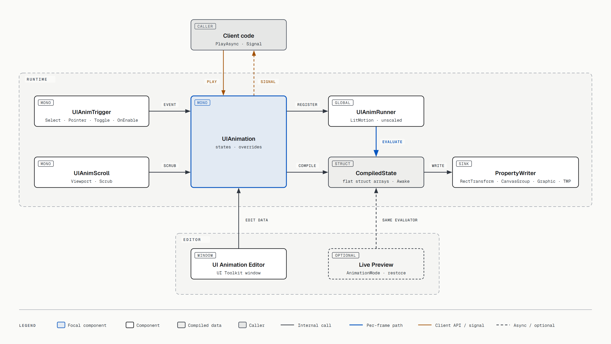
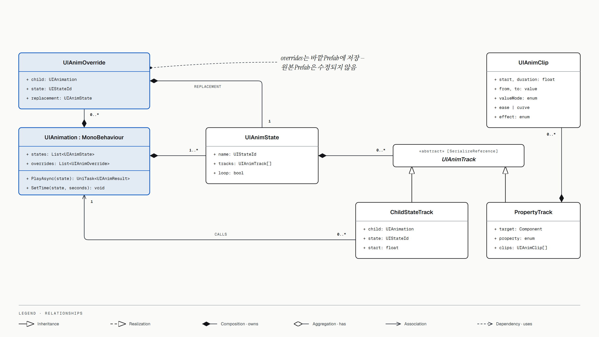
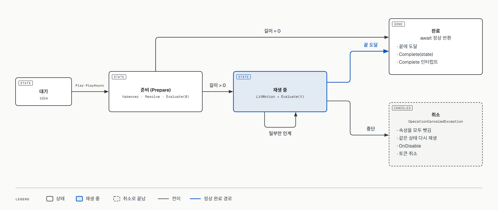

# UGUI Animation System — 설계 문서

> 기준: `main` 2b7cc83 (PR #14 머지 시점) · 2026-10-15
> 대상: Unity 6000.6.3f1 · uGUI 2.x (TMP 내장) · **서드파티 의존성 없음** (LitMotion 대신 자체 타이머·이징, 대기는 Unity `Awaitable`) · UniTask는 **선택**(설치돼 있으면 연동이 켜짐)
> 방식: **완전 커스텀**. 데이터, 런타임, 에디터 창을 모두 직접 만듭니다. Animator와 Timeline은 사용하지 않습니다.
> 표기: ✅ 구현됨 · 🟡 일부 구현 · ⬜ 아직 안 함
> 도식 원본(HTML)은 [`diagrams/`](diagrams/)에 있습니다. 브라우저로 열면 벡터로 볼 수 있습니다.

---

## 0. 한눈에 보기

| # | 요구사항 | 상태 | 현재 구현 |
|---|---|---|---|
| R1 | Prefab 단위로 관리 | ✅ | 애니메이션 데이터가 Prefab 안의 `UIAnimation` 컴포넌트에 직렬화됩니다. 별도 asset이 없습니다 (§3) |
| R2 | 디자이너가 편하게 편집 | ✅ | UI Toolkit 기반 **UI Animation Editor** 창: 계층형 타임라인, 트랙 추가 창, 키 인스펙터 (§6) |
| R3 | 성능 | ✅ | 버튼·텍스트·스크롤을 측정함. 재생 진행·스크롤은 할당 0회. 개선 후보: 글자 효과 텍스트당 약 0.2ms/프레임, 스크램블 문자열 할당 (§4.7) |
| R4 | 이벤트별 재생 (Pointer·Select·Toggle·OnEnable·Start) | ✅ | `UIAnimTrigger`, 상태마다 **Play On** 하나 (§5) |
| R5 | 공용 Prefab 중첩, 부모가 자식 상태 호출 | ✅ | 자식 호출(`UIAnimChildCall`): 부모 시간축의 지정 시간에 자식 상태 재생 (§4.4) |
| R6 | 상위에서 하위 오버라이드 (현재 Prefab에서만) | ✅ | **트랙 단위** 오버라이드. 바꾼 트랙만 저장하고 나머지는 원본을 따라감. Unity 중첩 Prefab 규칙과 같음 (§8) |
| R7 | Scroll 리스트와 애니메이션 | ✅ | `UIAnimScrollList` 하나로 스크롤 18가지 형태(리스트·그리드·메이슨리·캐러셀·무한 루프·페이지·배너·휠 피커·섹션 헤더·가변 크기·채팅·아코디언·중첩·탭·접히는 헤더·당겨서 새로고침). 모든 연출은 UI Animation Editor의 상태로 만듦 (§9) |
| R8 | Play 모드 없이 즉시 미리보기 | ✅ | 씬과 Prefab 모드 모두 지원. 정지·저장·Play 진입 시 원래 값으로 복원 (§6.6) |
| R9 | 클라이언트가 타이밍을 원활하게 호출 | ✅ | `PlayAsync`(Unity `Awaitable`, UniTask가 있으면 `PlayUniTaskAsync`)로 끝날 때까지 대기, `Complete`로 건너뛰기, 애니메이션 이벤트 수신 (§7) |

---

## 1. 왜 커스텀인가

| | Animator | Timeline | **커스텀 (채택)** |
|---|---|---|---|
| 대기 중 비용 | 매 프레임 값을 기록 → Canvas dirty | 낮음 (Manual 구동 시) | **0** (재생 중일 때만 계산) |
| 바인딩 | 경로 문자열 | 트랙 객체 기준. asset을 교체하면 끊어짐 | **Prefab 내부 컴포넌트 직접 참조** |
| 중첩 자식을 부모 시간축에서 펼쳐 편집 | 불가 | Timeline 창 확장 한계 | **가능** |
| 현재 Prefab에서만 자식 연출 오버라이드 | 불가 | 불가 | **가능** |
| 개발 비용 | 낮음 | 낮음 | 높음. 편집기 제작이 대부분 |

### 참고 레포에서 가져온 것

| 레포 | 가져온 것 |
|---|---|
| [UGUIAnimationSamples](https://github.com/annulusgames/UGUIAnimationSamples) | **샘플 콘텐츠 목표** (`1_Hover`, `2_Button`, `3_Text`, `4_Toggle`). 같은 시간·이징·LitMotion 공식(Punch/Shake/Scramble)으로 재현 |
| [Unity-AnimationUI](https://github.com/DhafinFawwaz/Unity-AnimationUI) | 인스펙터 기반 편집과 슬라이더 미리보기 UX |
| [UnityUIPlayables](https://github.com/Haruma-K/UnityUIPlayables) | 미리보기 후 값 복원 개념 |

---

## 2. 구조



[원본 HTML](diagrams/uianim-architecture.html)

| 파일 | 역할 |
|---|---|
| `Runtime/UIAnimation.cs` | 데이터 정의, 재생(`Play`/`PlayAsync`/`Complete`), 속성 인계, 값 계산(`Evaluate`), 이벤트·사운드·자식 호출(`Step`), 오버라이드 해석(`EffectiveState`), 속성 읽기/쓰기 |
| `Runtime/UIAnimTrigger.cs` | UI 이벤트 → 상태 재생 (Play On) |
| `Runtime/UIAnimEventListener.cs` | 애니메이션 이벤트 → 인스펙터의 UnityEvent |
| `Runtime/UIAnimScrollList.cs` | 가상화 스크롤 리스트: 정렬(세로·가로·그리드·메이슨리), 가변 크기·여러 Prefab, 재사용, 바인딩, 루프, 스냅·한 장씩, 자동 넘김, 섹션 헤더, 끝에 붙기, 크기 애니메이션, 중첩 드래그, 아이템 애니메이션 |
| `Runtime/UIAnimPageIndicator.cs` | 리스트 아이템마다 점·탭 하나, 현재 것에 On / 떠난 것에 Off 상태, 누르면 그 아이템으로 |
| `Runtime/UIAnimScrollScrub.cs` | 스크롤한 거리로 상태를 보여줌 (접히는 헤더) |
| `Runtime/UIAnimScreen.cs` | 화면 전환 컨테이너가 보여 주는 화면(Page·Modal·Sheet). 전환 = 상태 이름 규약, 생명주기 `IUIAnimScreenLifecycle` |
| `Runtime/UIAnimScreenContainer.cs`, `UIAnimPageContainer.cs`, `UIAnimModalContainer.cs`, `UIAnimSheetContainer.cs`, `UIAnimDefaultTransitions.cs` | 화면 전환 컨테이너와 기본 전환 (§7.4) |
| `Runtime/UIAnimPullToRefresh.cs` | 당긴 거리로 Pull 상태, 놓으면 On Refresh + Refreshing 반복, `EndRefresh()` |
| `Runtime/UIAnimTextChars.cs` | TMP 글자별 효과 누적과 메시 반영, 스크램블 텍스트 |
| `Runtime/UIAnimVibration.cs` | LitMotion과 같은 Punch/Shake 공식, 시드 랜덤, 스크램블 문자열 생성 |
| `Runtime/UIAnimTimer.cs` | 모든 재생·스크롤 움직임을 진행시키는 시계 하나 (실시간, Update 단계, 에디터에서는 EditorApplication.update) |
| `Runtime/UIAnimEase.cs` | `UIAnimEase`(이징 30종, LitMotion `Ease`와 같은 번호·공식), `UIAnimScramble`, `UIAnimEasing` |
| `Editor/UIAnimationEditorWindow.cs` | UI Animation Editor 창 (상단 바, 상태 탭, 인스펙터, 편집 명령) |
| `Editor/UIAnimTimelineView.cs` | 타임라인: 눈금자, 계층형 트랙 줄, 키·마커, 선택·드래그, 확대·이동, 우클릭 메뉴 |
| `Editor/UIAnimPropertyPicker.cs` | 트랙 추가 창 (오브젝트 트리 + 트랙 카드, 다중 선택) |
| `Editor/UIAnimMenu.cs` | 에디터 디자인의 우클릭 메뉴 |
| `Editor/UIAnimEaseGraph.cs` | 도착 방식 그래프 (읽기 전용) |
| `Editor/UIAnimPreview.cs` | Play 모드 없는 미리보기와 복원 |
| `Editor/UIAnimAudioPreview.cs` | 미리보기 중 사운드 재생 |
| `Editor/UIAnimationInspector.cs` | `UIAnimation` 인스펙터의 "Open UI Animation Editor" 버튼 |
| `Editor/UIAnimScrollListEditor.cs` | 스크롤 리스트 인스펙터 (Unity Layout Group과 같은 구성) + 에디터 미리보기 |
| `Editor/UIAnimStateField.cs` | "그 애니메이션의 상태" 한 줄: 상태 목록 + Edit / Create (UI Animation Editor로 열기) |
| `Editor/UIAnimScrollHelperEditors.cs` | Page Indicator · Scroll Scrub · Pull To Refresh 인스펙터 (같은 상태 줄 사용) |

런타임은 별도 "컴파일" 단계 없이 직렬화된 데이터를 그대로 평가합니다. 재생을 시작할 때 `Resolve`로 키 값을 한 번 확정하고(현재 값·원래 값·누른 위치 반영), 이후 매 프레임 `Step(t)`만 실행합니다.

---

## 3. 데이터 모델



[원본 HTML](diagrams/uianim-data-model.html)

```
UIAnimation : MonoBehaviour
 ├─ states      : List<UIAnimState>
 ├─ overrides   : List<UIAnimOverride>     // 중첩 자식 상태의 트랙 단위 오버라이드 (§8)
 └─ audioSource : AudioSource              // 선택. 비우면 공용 2D 소스

UIAnimState     { name, tracks, eventTracks, soundTracks, childCalls }
                // Duration = 트랙·이벤트·사운드 끝·자식 호출 끝 중 가장 늦은 시간

UIAnimTrack     { target: Component, property: UIAnimProperty,
                  start: KeyValue | Current | Pointer, relativeToRest,
                  stagger, durationPerChar, scramble,      // 텍스트 트랙 전용
                  keys: List<UIAnimKey> }                  // 0초 키부터, 시간순

UIAnimKey       { time, value: Vector4,
                  curveType: Ease | Curve | Punch | Shake,
                  ease, curve: AnimationCurve,
                  frequency, damping }                     // Punch/Shake 전용

UIAnimEventTrack { events: List<UIAnimEventMarker { time, name, dataType, dataJson }> }
UIAnimSoundTrack { source: AudioSource?, sounds: List<UIAnimSound { time, clip, volume }> }
UIAnimChildCall  { time, child: UIAnimation, state }
UIAnimOverride   { child: UIAnimation, state, tracks: List<UIAnimTrack> }   // 바꾼 트랙만
```

### 3.1 속성 (`UIAnimProperty`)

| 대상 | 속성 |
|---|---|
| Transform / RectTransform | `Scale`, `Rotation`(오일러 각, 읽을 때 -180~180), `SizeDelta`, `AnchoredPosition`, `AnchorMin`, `AnchorMax`, `Pivot` |
| GameObject | `Active`(켜기·끄기. 키 사이 보간 없이 키 시간에 바뀜) |
| CanvasGroup | `CanvasGroupAlpha` (화면·팝업 전체 페이드) |
| Camera | `CameraBackground`, `CameraOrthoSize` |
| Graphic (Image, TMP 등) | `GraphicColor`, `GraphicAlpha` |
| Image (Filled) | `FillAmount` |
| TMP_Text | `FontSize`, `CharacterSpacing`, `TextReveal` (타자기, 0~1) |
| TMP_Text 글자별 | `CharScale`, `CharOffset`, `CharRotation`, `CharColor`, `CharAlpha` |
| UIEffect (설치돼 있을 때) | `UIEffectToneIntensity`, `…ColorIntensity`, `…Color`, `…SamplingIntensity`, `…TransitionRate`(디졸브 등), `…TransitionColor`, `…EdgeShinyRate`, `…EdgeColor`, `…GradationIntensity/Offset/Rotation/Scale`, `…DetailIntensity`, `…DetailColor` — UIEffect의 Timeline 트랙과 같은 14종 (§7.3) |

### 3.2 키프레임과 도착 방식
- Unity Animation 창처럼 트랙마다 키(시간, 값)를 찍습니다. 1 → 1.2 → 1은 키 3개입니다.
- **모든 트랙은 0초 키를 가집니다.** 새 트랙은 0초 키와 끝 키로 만들어지고, 0초 키가 없는 트랙에 키를 추가하면 0초 키가 먼저 생깁니다. 0초 키도 다른 키처럼 옮기고 편집할 수 있습니다.
- 키의 도착 방식은 **이전 키에서 이 키로 오는 방식**입니다.
  - `Ease`: `UIAnimEase` 프리셋 30종 (LitMotion `Ease`와 같은 번호·공식이라 예전에 저장한 Prefab을 그대로 읽음)
  - `Curve`: AnimationCurve. 0 = 이전 키 값, 1 = 이 키 값
  - `Punch`: 이전 값을 중심으로 흔들리다 이전 값으로 돌아옵니다. 키 값은 목적지가 아니라 **세기**입니다.
  - `Shake`: Punch와 같지만 축마다 매 프레임 무작위로 흔들립니다.
  - Punch/Shake의 감쇠 진동 공식과 랜덤은 LitMotion과 같습니다(`Frequency`, `Damping`).

### 3.3 트랙 옵션
- `Start`: 첫 키 값을 어디서 가져올지 정합니다.
  - `Key Value`: 키에 적힌 값
  - `Current`: 재생을 시작하는 순간의 값. 중간에 끊겨도 값이 튀지 않습니다(호버/언호버, 팝업 Open/Close). 첫 키를 0초 뒤에 두면 그만큼 기다립니다(Toggle1의 지연).
  - `Pointer`: **Position 트랙 전용.** 상태를 재생시킨 포인터를 누른 위치입니다. 뒤 키들은 누른 자리 기준 상대값이라 `(0,0)`은 "그 자리"입니다(Button2의 리플). 포인터 없이 재생하면(코드 호출) 현재 위치를 씁니다.
- `Relative To Rest` (원래 값 기준): 키 값을 원래 값(Awake 시점, 미리보기는 시작 시점에 캡처)에 더합니다. 예: Button1 누를 때 크기 −(34, 17).
- `Size Relative` (자기 크기 기준): **Position·Size 트랙 전용.** 키 값이 대상 자기 크기의 배수입니다(x = 1이면 자기 폭만큼). 재생을 시작할 때 크기를 읽어서 해상도가 달라도 같은 비율로 움직입니다. 예: 화면이 x = 1(오른쪽 한 화면)에서 0으로 들어오기. 다른 트랙에서는 보이지만 비활성(이유 표시)입니다.

### 3.4 텍스트 트랙
- `TextReveal`: `maxVisibleCharacters`를 0~1 비율로 지정합니다. 리치 텍스트 태그는 글자 수에 포함하지 않습니다.
  - `Scramble`: 아직 안 나온 글자를 무작위 문자로 채웁니다(`UIAnimScramble`, LitMotion `ScrambleMode`와 같은 번호). 원문의 공백은 유지해서 줄바꿈이 튀지 않습니다.
- 글자별 트랙(`Char*`)
  - 키는 **글자 하나의 움직임**입니다.
  - `Stagger`(글자 간격): i번째 글자가 i × stagger초 늦게 시작합니다. 트랙 끝 = 마지막 키 + (글자 수 − 1) × stagger
  - `Duration per Char`(글자당 길이): 0보다 크면 i번째 글자가 키 전체를 i × 이 값(초) 동안 재생합니다(Shake 샘플).
  - 같은 텍스트의 글자 트랙 여러 개(크기 + 위치 + 색 등)는 누적된 뒤 메시를 한 번만 갱신합니다.

### 3.5 예전 데이터 변환
불러올 때 자동으로 바뀌므로 수동 작업이 필요 없습니다.

| 예전 | 지금 |
|---|---|
| 상태의 `events`/`signals`, `sounds` 목록 | 이벤트 트랙·사운드 트랙 하나로 이동 |
| 트랙의 `startFromCurrent` (bool) | `start` (false → Key Value, true → Current) |
| 오버라이드의 `replacement` (상태 전체 복사본) | 그 안의 트랙을 오버라이드 트랙으로 이동 |

---

## 4. 런타임 재생

### 4.1 재생 흐름
1. `Prepare`: 같은 상태가 재생 중이면 멈추고, 다른 상태와 겹치는 속성을 인계받고(§4.2), 키 값을 확정(`Resolve`)한 뒤 **0초 값을 바로 씁니다.**
2. `UIAnimTimer`에 상태 길이만큼의 타이머를 하나 걸고, 매 프레임 `Step(t)`를 호출합니다. 콜백은 상태 객체를 넘기는 static 함수라 할당이 없습니다. 시간은 실시간(Time Scale 무시)이고, Play 모드에서는 플레이어 루프의 Update 단계, 에디터에서는 `EditorApplication.update`로 돌아갑니다.
3. `Step(t)` = 값 계산(`Evaluate`) + 이번 프레임에 지난 `(이전 t, t]` 구간의 사운드·자식 호출·이벤트 실행
4. 끝에 도달하면 완료 처리합니다.

0초 값을 바로 쓰는 이유: 대사창처럼 text를 바꾸고 타자기를 재생하면, 그렇지 않을 때 새 대사가 한 프레임 동안 전부 보입니다.

### 4.2 속성 단위 인계
- 여러 상태가 동시에 재생될 수 있습니다. 새 상태는 **자기가 건드리는 속성만** 이전 상태에서 가져오고, 나머지는 계속 재생됩니다(Button2의 Hover와 Press).
- 중단 방식(`UIAnimInterrupt`)
  - `Cancel`: 겹치는 속성만 가져오고, 속성을 모두 잃은 상태는 멈춥니다.
  - `Complete`: 겹치는 상태를 끝 값으로 맞춘 뒤 시작합니다(Button2의 Press/Release).

### 4.3 완료와 취소



[원본 HTML](diagrams/uianim-playback.html)

상태마다 "끝까지 감"과 "중간에 멈춤" 두 경로만 있습니다. 모든 정지 경로가 둘 중 하나를 거치므로, 대기 중인 Task가 걸린 채 남는 경우가 없습니다.

| 경우 | 결과 | 남은 이벤트 | 남은 사운드 |
|---|---|---|---|
| 끝에 도달 | 완료 | 모두 발생 | 모두 재생 |
| `Complete(state)` 호출 | 끝 값으로 이동 후 완료 | 순서대로 발생 | 재생 안 함 |
| 다른 상태가 `Complete` 인터럽트로 시작 | 끝 값으로 이동 후 완료 | 순서대로 발생 | 재생 안 함 |
| 다른 상태가 속성을 모두 가져감 | 취소 | 발생 안 함 | 재생 안 함 |
| 같은 상태를 다시 재생 | 이전 재생은 취소 | 발생 안 함 | 재생 안 함 |
| 오브젝트 비활성화(`OnDisable`) | 취소 | 발생 안 함 | 재생 안 함 |
| `PlayAsync`에 넘긴 토큰 취소 | 멈추고 취소 | 발생 안 함 | 재생 안 함 |

### 4.4 자식 호출
- 부모 상태의 지정 시간에 자식 `UIAnimation`의 상태를 재생합니다(Popup1이 Open 0.3초에 닫기 버튼의 Hover 재생).
- 부모 길이에 `호출 시간 + 자식 상태 길이`가 포함됩니다. 자식 상태는 오버라이드가 적용된 것을 씁니다(§8).
- 부모를 `Complete`하면 자식도 끝 값이 됩니다. 부모가 취소돼도 이미 시작한 자식은 계속 재생됩니다.
- 서로 호출하는 순환은 깊이 8에서 끊습니다.

### 4.5 애니메이션 이벤트와 사운드
- **이벤트**: 이벤트 트랙의 시점마다 `EventRaised`가 발생합니다. 이름만 있는 이벤트와 `[UIAnimEvent]` struct 데이터를 가진 이벤트가 같은 형식입니다(§7.5).
- **사운드**: 사운드 트랙의 시점마다 `PlayOneShot`으로 재생합니다.
  - 소스 우선순위: 트랙의 AudioSource → UIAnimation의 `audioSource` → **공용 2D AudioSource**(숨김 오브젝트 하나). 그래서 UI 오브젝트에 AudioSource를 붙일 필요가 없습니다. 믹서 그룹이나 3D 사운드가 필요할 때만 지정합니다.
  - 상태 길이에 사운드 끝까지 포함됩니다. 그래서 Close 후 Destroy해도 소리가 끊기지 않습니다.

### 4.6 텍스트
- 텍스트 속성을 쓰는 상태는 재생 시작 때 TMP 메시를 다시 만들어 글자 수를 새로 읽습니다. 그래서 text를 바꾼 뒤 재생하면 길이와 글자 간격이 새 텍스트 기준입니다.
- 스크램블은 text 자체를 바꾸므로 원문을 따로 기억합니다. 재생 중에 외부에서 text가 바뀌면 그것을 새 원문으로 씁니다.

### 4.7 성능 현황

**구조**
| 항목 | 내용 |
|---|---|
| 대기 중 | 재생 중이 아닌 상태는 비용 0 (타이머가 없음) |
| 재생 대기 | `PlayAsync`는 Unity `AwaitableCompletionSource`를 상태마다 하나 만들어 재사용(`Reset`). `Play`는 대기 소스를 만들지 않음 |
| 오버라이드 | 오버라이드가 있는 상태는 합친 상태를 만듭니다. 재생 준비 때 한 번, 자식 호출 길이 계산 때 재생마다 한 번 할당 |
| 글자 효과 | 텍스트당 프레임마다 메시 재생성 1회(`ForceMeshUpdate`) |
| 스크램블 | 공개 중에는 프레임마다 문자열 1개 생성 (TMP가 string을 요구) |
| 스크롤 리스트 | 아이템 위치는 레이아웃이 바뀔 때 한 번 계산, 보이는 범위는 이진 탐색(메이슨리만 전체 검사). 측정 리스트는 개수가 늘면 새 아이템만 측정 |

**측정** (`PerformanceTests`, `UIAnimScrollListTests`의 성능 테스트 · EditMode · 개발 PC · 샘플 Prefab). 시간은 실행마다 ±30% 정도 흔들립니다.

| 대상 | 시간 | GC 할당 |
|---|---|---|
| Button1 100개 `Play(Hover/Unhover)` 시작 | 약 0.26ms / 100개 (LitMotion 때 0.37~0.45ms) | **0회** (LitMotion 때 0.46회) |
| Button1 100개 Hover 진행 | 약 0.13~0.16ms / 프레임 | **0회** |
| TextDemo 10개 Typewriter | 약 0.01ms / 프레임 | **0회** |
| TextDemo 10개 Scramble | 약 0.06ms / 프레임 | 10회 / 프레임 (텍스트당 문자열 1개) |
| TextDemo 10개 Flip · PopUp · Punch · Shake (글자 효과) | 약 2.0~2.5ms / 프레임 (텍스트당 약 0.2ms) | **0회** |
| 스크롤 100개 점프 1000번: 바인딩만 / 위치 스크럽 포함 | 약 35~41µs / 95~121µs (점프당) | **0회** |
| 섹션 헤더 1000개 점프 | 약 0.2~0.25ms (점프당) | 0.002회 (풀이 새 최대 개수로 커질 때) |
| 메이슨리 1000개 점프 | 약 0.75~0.8ms (점프당) | 14.8회 (아래 참고) |
| 측정 리스트(말풍선) 200개 채우기 / 1개 추가 | 약 38ms / 약 0.6ms | 243회 / 13회 |

- **측정 방법 정정**: 처음 스크롤 측정에 쓴 `GC.GetAllocatedBytesForCurrentThread()`는 Unity Mono에서 **항상 0을 돌려줍니다**(1KB 배열을 할당해도 0). 그래서 이전 문서의 "GC 0바이트"는 근거가 없었습니다. 지금은 Unity Test Framework의 할당 검사와 같은 프로파일러 `GC.Alloc` 기록기로 **할당 횟수**를 셉니다. 측정 도구 자체를 검증하는 테스트가 있습니다(할당 없는 코드 0회, 1KB 배열 1번 = 1회).
- **메이슨리 할당**: 우리 코드가 아니라, 재사용한 아이템의 높이가 바뀔 때 TMP 텍스트가 크기 변경에 반응하며 생깁니다. 높이를 모두 같게 하거나 글자를 끄면 0회입니다.
- **측정 리스트**: 1개 추가가 전체를 다시 재던 것(200개 기준 약 42ms, 프레임 멈춤)을 새 아이템만 재도록 고쳐 약 0.6ms가 됐습니다. 기존 아이템의 데이터가 바뀌면 `Refresh()`(전체) 또는 `RefreshItem(i)`(하나)를 부릅니다.
- **개선 후보**: 글자 효과는 텍스트 10개 동시 재생에 프레임당 2ms 남짓이라, 한 화면에 수십 개를 동시에 돌리면 부담이 됩니다. 스크램블은 텍스트당 프레임마다 문자열 1개를 만듭니다.

---

## 5. 재생 시점 — Play On (`UIAnimTrigger`)

상태마다 **재생 시점 하나**를 정합니다. 상태 인스펙터의 `Play On`에서 고르고, 필요하면 `UIAnimTrigger`가 자동으로 추가됩니다.

| Play On | 출처 |
|---|---|
| `None` | 자동 재생 안 함. 직접 코드에서 `Play`/`PlayAsync` 호출 |
| `OnEnable` | 컴포넌트 활성화 |
| `Start` | 처음 활성화된 뒤 한 번 |
| `PointerEnter` / `PointerExit` / `PointerDown` / `PointerUp` / `Click` | `IPointer*Handler` |
| `Select` / `Deselect` | `ISelectHandler` / `IDeselectHandler` |
| `ToggleOn` / `ToggleOff` | `Toggle.onValueChanged` |

- 이벤트를 고르면 `Interrupt`(§4.2)도 함께 정합니다.
- **같은 순간에 재생되는 상태가 둘이면 경고**합니다. 예: `OnEnable`과 `Start`는 Instantiate할 때 둘 다 호출됩니다.
- 상호작용 불가(`interactable = false`)인 Selectable은 입력 이벤트를 무시합니다. `OnEnable`·`Start`는 그래도 재생합니다.
- 상태 이름을 바꾸면 바인딩도 따라 바뀌고, 상태를 지우면 바인딩도 지워집니다.
- UnityEvent(예: Button.onClick)에서는 `PlayState(string)`을 연결합니다.

---

## 6. 에디터 — UI Animation Editor

`Window/UI Animation Editor` 메뉴 또는 `UIAnimation` 인스펙터의 **Open UI Animation Editor** 버튼으로 엽니다. 선택한 오브젝트(또는 부모)의 `UIAnimation`을 편집합니다. 에디터 UI는 영문입니다.

### 6.1 창 구성
| 영역 | 내용 |
|---|---|
| 상단 바 | 재생/정지/반복, 속도(0.1x~1x), 현재 시간/전체 길이, 미리보기 상태 표시 |
| 상태 탭 | 상태 선택·추가. 탭 툴팁에 Play On |
| 타임라인 (왼쪽) | 오브젝트 계층으로 묶인 트랙 줄, 눈금자, 상태 끝(`End`) 표시 |
| 인스펙터 (오른쪽) | 상태 / 트랙 / 키 / 이벤트 / 사운드 / 자식 호출 |

### 6.2 타임라인
- **계층**: 트랙이 대상 오브젝트의 Hierarchy 구조로 묶여 보이고, 오브젝트 줄을 접을 수 있습니다(접으면 키 요약 표시).
- **트랙 종류**: 키프레임 트랙, 애니메이션 이벤트 트랙, 사운드 트랙(클립 길이만큼 막대, AudioClip 끌어다 놓기 가능), 자식 호출(오브젝트 줄의 막대).
- **자식 호출 아래 트랙**: 호출된 자식 상태의 트랙이 호출 시간만큼 밀려서 부모 시간축에 그대로 보입니다. 오버라이드 편집은 §8.
- **키 편집**: 클릭, Shift/Ctrl 클릭, 박스 선택, 여러 키 드래그, Delete. 줄 빈 곳을 더블클릭하면 키 추가.
- **보기**: 눈금자 위 휠 또는 Ctrl+휠로 확대·축소, Shift+휠·가로 휠·휠 버튼 드래그로 좌우 이동, `F` 또는 `⤢`로 전체 보기.
- **상태 끝**: 눈금자에 `End 0.80s` 표시, 그 뒤는 어둡게 칠해집니다(Unity Animation 창의 클립 끝 이후 영역처럼).
- **글자 트랙**: 마지막 키 뒤 연한 꼬리가 뒤 글자들이 재생되는 구간입니다. 꼬리 끝 핸들을 끌면 `Stagger`가 바뀝니다.
- **우클릭 메뉴**(에디터 디자인): `Add Track...`, `Add Child Call ▸ 오브젝트 ▸ 상태`(이미 호출 중인 상태는 ✓·비활성), 트랙·키·마커별 추가·삭제·되돌리기.

### 6.3 트랙 추가 창
- 왼쪽에 Prefab 안 오브젝트 트리, 오른쪽에 그 오브젝트에서 만들 수 있는 트랙 카드(현재 값 미리보기 포함). 검색 가능.
- 카드를 클릭해 여러 개 고른 뒤 `Add N`, 또는 더블클릭으로 바로 추가. 오브젝트를 옮겨 다니며 골라도 선택이 유지됩니다.
- 루트에는 `Animation Events`, `Sound` 카드, AudioSource가 있는 오브젝트에는 `Sound` 카드가 있습니다.

### 6.4 인스펙터
- **상태**: 이름, Play On(§5)
- **트랙**: 대상 변경, `Start`, `Relative To Rest`. 텍스트 트랙은 Stagger·Duration per Char 또는 Scramble
- **키**: 어떤 키든 `Key`(Time, Value, Capture Current Value) → `Arrival`(Type, Ease, Frequency·Damping, AnimationCurve, 그래프) 순서
  - 해당하지 않는 칸은 숨기지 않고 **비활성화 + 이유 한 줄**입니다. 예: 시작 값이 재생 때 정해지는 키의 Value, 첫 키의 Arrival.
  - 값 라벨은 의미에 따라 `Value` / `Value (rest +)` / `Value (press point +)` / `Strength`(Punch/Shake)
- **이벤트**: 이름, 시간, 형식(`Name Only` 또는 `[UIAnimEvent]` struct). struct 필드를 바로 편집
- **사운드**: 클립, 볼륨, 시간, 미리 듣기
- **자식 호출**: 자식, 상태, 시간
- 모든 편집은 Unity Undo로 되돌릴 수 있습니다.

### 6.5 같은 형태 규칙
같은 개념은 항상 같은 모양으로 그립니다. 다르게 보여야 하는 경우가 생기면 먼저 확인을 받고 만듭니다.
1. 내 트랙·오버라이드한 트랙·원본(읽기 전용) 트랙은 같은 줄 하나로 그리고, 읽기 전용은 흐리게만 표시합니다.
2. 키는 항상 같은 다이아몬드이고 잘리지 않습니다(줄 왼쪽 여백 9px). 상태 차이는 색으로만 표시합니다.
3. 트랙은 움직이는 구간을 같은 막대로 그립니다. 글자 꼬리·끝 핸들은 그 위에 더하기만 합니다.
4. 같은 종류의 인스펙터는 섹션 구성이 같습니다(§6.4).
5. 옵션은 데이터의 의미만 바꾸고 화면 모양은 바꾸지 않습니다.

### 6.6 Play 모드 없는 미리보기
- 런타임과 **같은 계산**을 씁니다. 그래서 미리보기와 실제 재생 결과가 같습니다. 자식 호출과 오버라이드도 반영됩니다.
- **씬**: 바뀌는 속성을 `AnimationMode`에 등록하고, 값은 샘플링 블록 밖에서 씁니다. 블록을 닫을 때(`EndSampling`) 등록된 속성이 원래 값으로 되돌아가기 때문입니다. 정지하면 복원됩니다.
- **Prefab 모드**: Scene 뷰가 샘플링 블록 밖에서 쓴 값을 다시 그리지 않아서, 속성을 등록하지 않고 블록 안에서 씁니다. 복원은 시작 시점의 스냅샷으로 합니다.
  - 미리보기 후 Prefab에 '수정됨'(`*`) 표시가 생깁니다. 값은 정확히 복원되므로 저장해도 내용은 같습니다.
- **사운드**: 재생 중에 지나간 사운드를 에디터 오디오로 들려줍니다. 눈금자를 끌 때는 재생하지 않습니다.
- **시작 상태 자동 결정**: 어떤 상태는 다른 상태가 끝난 모습에서 시작해야 움직임이 보입니다.
  1. 트리거 이벤트 짝: Exit←Enter, Up←Down, Deselect←Select, ToggleOff←ToggleOn
  2. 이름 짝 (코드로 재생하는 상태): Open↔Close, Show↔Hide, In↔Out
- **자동 정지·복원 시점**: 정지 버튼, 다른 `UIAnimation` 선택, 씬/Prefab 저장 직전, 씬 닫기·되돌리기, Play 모드 진입, 스크립트 리로드, 창 닫기.

---

## 7. 클라이언트 API

### 7.1 재생
```csharp
public sealed class UIAnimation : MonoBehaviour
{
    public void Play(string stateName, UIAnimInterrupt interrupt = UIAnimInterrupt.Cancel,
                     PointerEventData pointer = null);
    public Awaitable PlayAsync(string stateName, UIAnimInterrupt interrupt = UIAnimInterrupt.Cancel,
                               CancellationToken cancellationToken = default);   // Unity 내장, 한 번만 await
    public void PlayReversed(string stateName, UIAnimInterrupt interrupt = UIAnimInterrupt.Cancel);
    public Awaitable PlayReversedAsync(string stateName, UIAnimInterrupt interrupt = UIAnimInterrupt.Cancel,
                                       CancellationToken cancellationToken = default);
    public void PlayStateReversed(string stateName);   // UnityEvent 연결용 (Back 버튼)
    public void Complete(string stateName);   // 재생 중인 상태를 끝으로 건너뛰기 (역재생이면 시작 모습)
    public void Stop(string stateName);       // 그 자리에서 멈춤 (반복 상태를 끌 때). 기다리던 PlayAsync는 취소
    public bool IsPlaying(string stateName);
    public void PlayState(string stateName);  // UnityEvent 연결용
    public void Sample(string stateName, float time);   // 재생하지 않고 그 시간의 모습만 (이벤트·사운드 없음)
    public float Duration(string stateName);
}
```

**역재생** — 값은 끝에서 시작으로, 이벤트·사운드·자식 호출도 거꾸로 한 번씩 발생합니다(자식 상태도 역재생). 시작 값이 "현재 값"인 트랙은 마지막 정방향 재생이 잡은 값을 다시 써서, Back이 Open을 시작한 자리로 정확히 돌아갑니다. 이징 곡선은 시간을 거꾸로 따라가므로 뒤집힌 모양이 됩니다.

**반복 (상태의 Loop)** — Animator 클립의 Loop Time과 같은 개념입니다. 상태 인스펙터의 **Loop** 토글을 켜면, 끝에 닿았을 때 남은 시간을 넘겨 0초부터 이어서 재생해 이음매가 없습니다. 이벤트·사운드·자식 호출은 바퀴마다 다시 울리고, 역재생 반복도 됩니다. `Stop`이나 다른 상태가 속성을 가져갈 때까지 계속되므로, 반복 상태의 `PlayAsync`는 `Complete`/`Stop` 전에는 끝나지 않습니다. 켜질 때 바로 돌게 하려면 Play On에 On Enable을 고릅니다(코드 불필요). 창의 미리보기도 반복합니다. 예: 로비 영웅 숨쉬기, 소환 마법진 회전, 알림 표시 맥박.

**팝업 닫기** — 닫히는 도중 다시 열리면 Destroy하지 않습니다.
```csharp
try { await popup.PlayAsync("Close", cancellationToken: popup.destroyCancellationToken); }
catch (OperationCanceledException) { return; }   // Open이 Close를 가져감 → 팝업 유지
Destroy(popup.gameObject);
```

**대사창** — 같은 TMP의 text를 바꿔 가며 재생하고, 스킵은 `Complete`.
```csharp
dialogue.text = nextLine;
var typing = anim.PlayAsync("Typewriter");
// 스킵 버튼: anim.Complete("Typewriter");
await typing;
```

### 7.3 UIEffect 트랙 (선택)
UIEffect(`com.coffee.ui-effect` 5.x)가 설치돼 있으면 asmdef `SeoBYP.TimelineAnimation.UIEffect`(versionDefines `UIANIM_UIEFFECT`)가 컴파일되어, UIEffect가 붙은 오브젝트의 트랙 고르기 창에 **UIEffect 14종**(위 표)이 나옵니다. 다른 트랙과 똑같이 키·이징·Start(Current 등)·미리보기(편집 모드, 끝나면 원래 값으로 복원)·역재생·반복이 됩니다. 숫자는 UIEffect의 범위대로 슬라이더(예: Gradation Rotation 0~360), 색은 색 필드입니다. 설치하지 않으면 이 속성들은 목록에 나오지 않고, 저장돼 있던 트랙은 아무것도 하지 않습니다.
- 구조: 코어는 UIEffect를 참조하지 않습니다. `UIAnimProperty`에 이름만 있고, 읽기·쓰기·필드 이름·범위는 연동 어셈블리가 `UIAnimExternalProperties.Register`로 등록합니다(에디터 `InitializeOnLoadMethod` + 런타임 `RuntimeInitializeOnLoadMethod`). 다른 라이브러리도 같은 방식으로 붙일 수 있습니다.
- 확인: UIEffect 있음 → EditMode `UIAnimUIEffectTests` 2개(값 보간·읽기, 고르기 창 14종·이름). UIEffect 없음 → `Benchmarks` 프로젝트에서 컴파일 오류 0.

### 7.2 UniTask 연동 (선택)
UniTask(`com.cysharp.unitask`)가 설치돼 있으면 asmdef `versionDefines`가 `UIANIM_UNITASK`를 켜서 확장 메서드가 생깁니다. 설치하지 않아도 패키지는 그대로 컴파일·동작합니다(VContainer·LitMotion의 UniTask 연동과 같은 방식).
```csharp
await UniTask.WhenAll(popup.PlayUniTaskAsync("Open"), dim.PlayUniTaskAsync("Show"));
var info = await anim.WaitEventUniTaskAsync("Shown");
var canceled = await popup.PlayUniTaskAsync("Close").SuppressCancellationThrow();
```
- 완료·취소 규칙은 `PlayAsync`와 같습니다(내부적으로 `Awaitable`을 `AsUniTask()`로 바꿈).
- 샘플 `Samples/UniTask`(UniTask 설치 시에만): `WhenAll`, `SuppressCancellationThrow`, `Timeout` + `Complete`, `WaitEventUniTaskAsync`, `destroyCancellationToken`.

### 7.2.1 R3 연동 (선택)
R3(`com.cysharp.r3`)가 설치돼 있으면 `versionDefines`가 `UIANIM_R3`를 켭니다.
```csharp
open.OnClickAsObservable().ThrottleFirst(TimeSpan.FromSeconds(0.5))
    .SelectMany(_ => popup.PlayAsObservable("Open"))          // 끝나면 Unit 하나, 끝나지 못하면 OperationCanceledException
    .Subscribe(_ => Debug.Log("열림")).AddTo(this);
popup.EventAsObservable("Shown").Subscribe(e => Debug.Log(e.Time)).AddTo(this);   // EventsAsObservable() = 전부
```
- 구독을 끊으면 상태가 그 자리에서 멈춥니다.
- 샘플 `Samples/R3`: 버튼 연타 `ThrottleFirst`, 닫기 `Switch`, 이벤트 로그. 테스트 `R3PlayModeTests` 4개 + 샘플 1개(R3 설치 시에만).

### 7.4 화면 전환 (Page · Modal · Sheet 컨테이너)
UnityScreenNavigator와 같은 역할을 패키지 안에서 합니다. 전환 연출은 **화면의 UIAnimation 상태**이고, 화면에 그 이름의 상태가 없으면 기본 전환을 씁니다.

| 컨테이너 | API | 화면의 상태 이름 | 기본 전환 (USN 기본값과 같음, 0.3초) |
|---|---|---|---|
| `UIAnimPageContainer` | `Push(prefab, animated, stack)`, `Pop(animated)`, `Pages`, `Current` | `PushEnter`, `PushExit`, `PopEnter`, `PopExit` | 한 화면 폭 슬라이드(Size Relative), OutQuart |
| `UIAnimModalContainer` | `Push(prefab, animated)`, `Pop(animated)`, `backdropPrefab` | `Enter`, `Exit` (배경도 `Enter`/`Exit`) | 크기 0.3→1 + 알파, 배경은 검정 75 % 페이드(Linear) |
| `UIAnimSheetContainer` | `Register(prefab)`, `Show(index, animated)`, `ActiveIndex` | `Enter`, `Exit`, 낮은 번호로 갈 때 `EnterBackward`, `ExitBackward`(없으면 `Enter`/`Exit`) | 알파 페이드(Linear) |

- 들어오는 화면과 나가는 화면이 **동시에** 움직입니다. 들어오는 화면은 컨테이너를 꽉 채웁니다.
- `stack: false`로 넣은 페이지는 다음 페이지가 들어오면 기록에서 빠집니다(로딩 화면). `renderingOrder`가 높은 화면이 위에 그려집니다.
- 생명주기: 화면 루트의 아무 컴포넌트가 `IUIAnimScreenLifecycle`을 구현하면 `WillEnter`/`WillExit`(await, 애니메이션 전), `DidEnter`/`DidExit`(애니메이션 후)가 불립니다. `UIAnimTransition`에 종류(Push/Pop/Show/Hide), 상대 화면(`Partner`), 방향(`Backward`)이 들어 있습니다. 기다릴 게 없는 `Will*`은 `UIAnimScreen.Completed()`를 돌려줍니다.
- **공유 요소 전환** (`UIAnimSharedElement.SetPartnerKeys`): 이미지가 다른 화면의 자리에서 이어져 나오는 연출. 연출 자체는 움직이는 이미지의 AnchoredPosition·SizeDelta 트랙(창에서 편집)이고, 실행 중에만 알 수 있는 상대 쪽 자리(첫 키 또는 마지막 키)만 `Will*`에서 채웁니다. 상대 이미지는 들어갈 때 숨기고 `DidExit`에서 다시 보이게 합니다(Showcase 상점 상세, ScreenNavigator 초상화 뷰어).
- 전환 중에는 **모든 컨테이너의 입력이 잠깁니다**(`AnyInTransition`). 중복 터치로 전환이 겹치지 않습니다.
- 전부 `Awaitable`이라 서드파티 없이 `await pages.Push(home)`로 기다릴 수 있습니다.

```csharp
await pages.Push(loadingPage, stack: false);   // 로딩: 기록에 안 남음
await pages.Push(homePage);                     // Home의 WillEnter에서 1초 준비하는 동안 로딩이 보임
await sheets.Show(2);                           // 탭 2 (높은 번호: Enter, 낮은 번호: EnterBackward)
```

### 7.5 애니메이션 이벤트
```csharp
[UIAnimEvent("Popup Sound")]                 // 에디터의 이벤트 형식 목록에 나옴
public struct PopupSoundEvent { public string clip; public float volume; }

anim.EventRaised += (in UIAnimEventInfo e) => Debug.Log($"{e.State}:{e.Name} @ {e.Time}");
using var sub = anim.AddListener<PopupSoundEvent>((in UIAnimEventInfo e, in PopupSoundEvent data) => Play(data.clip));
var info = await anim.WaitEventAsync("Shown");
```
- `WaitEventAsync`는 `Awaitable<UIAnimEventInfo>`입니다.
- `UIAnimEventInfo`(readonly struct, `in`으로 전달): `Animation`, `State`, `Name`, `Time`, `TryGetData<T>()`
- 코드 없이 받기: `UI Anim Event Listener` 컴포넌트에 이벤트 이름 → UnityEvent를 연결합니다.
- 이벤트 형식 목록에는 플레이어 빌드에 포함되는 struct만 나옵니다(테스트 어셈블리 제외).

**정책**
- 끝나지 않은 재생은 **취소(OperationCanceledException)**로 끝납니다. "끝나야만 다음 동작"이 기본이 되도록 하기 위해서입니다. UniTask를 쓰면 `PlayUniTaskAsync(...).SuppressCancellationThrow()`로 예외 없이 받을 수 있습니다.
- 상태는 문자열 이름으로 지정합니다. 없는 이름은 경고 로그를 남기고 무시합니다.

---

## 8. 현재 Prefab에서만 동작하는 오버라이드 (트랙 단위)

> **오버라이드는 그것을 만든 Prefab 안에서만 동작한다. 원본 Prefab의 애니메이션은 절대 수정되지 않는다.**

- **저장 위치**: 자식 인스턴스의 필드가 아니라 **바깥 Prefab 자신의 `UIAnimation.overrides`**에 `{자식, 상태 이름, 바꾼 트랙들}`로 저장합니다. 그래서 원본 Prefab 파일은 바뀌지 않습니다.
- **트랙 단위**: 바꾼 트랙만 저장합니다. 원본 트랙과는 대상 오브젝트 + 속성으로 매칭합니다.

| 원본 Prefab에서 일어난 일 | 오버라이드한 트랙 | 오버라이드 안 한 트랙 |
|---|---|---|
| 키 값·시간 수정 | 팝업 값 유지 | 팝업도 따라감 |
| 트랙 추가 | — | 팝업에도 생김 |
| 트랙 삭제 | 팝업에 남음 | 팝업에서도 사라짐 |

- **여러 단계 (Unity 중첩 Prefab 규칙과 같음)**: 같은 트랙을 여러 단계가 오버라이드하면 **가장 바깥이 이깁니다**(예: Screen > Popup1 > Button).
- **에디터에서**
  - 지금 맥락에서 실제 재생되는 값을 보여 줍니다. 어느 단계든 오버라이드된 트랙은 **파란 이름**이고 편집할 수 있으며, 툴팁에 덮어쓴 Prefab(`Overridden in Screen`)이 나옵니다. 편집은 그 단계의 오버라이드를 고칩니다.
  - 흐린 원본 트랙을 클릭하면 **그 트랙만** 오버라이드됩니다.
  - `×`: 그 트랙의 가장 바깥 단계 하나만 지웁니다. 아래 단계 값이 다시 보이고, 다 지우면 원본입니다.
  - `↺`: 가장 바깥 단계의 오버라이드 전체를 지웁니다(Unity의 Revert All).
  - 씬 인스턴스에서 만든 오버라이드는 Unity의 Prefab 인스턴스 오버라이드로 기록되므로, Inspector › Overrides › Revert도 동작합니다.

---

## 9. 스크롤 리스트 (`UIAnimScrollList`)

`ScrollRect`에 붙이는 **가상화 리스트**입니다. 화면에 보이는 아이템만 만들고, 스크롤하면 그 오브젝트들을 재사용합니다.
스크롤 형태는 따로 컴포넌트를 두지 않고 이 리스트의 설정 조합으로 만들고, **연출은 전부 아이템(또는 점·헤더)의 `UIAnimation` 상태**입니다.

### 9.1 정렬 (인스펙터는 Unity Layout Group과 같은 구성)
| Layout | 항목 |
|---|---|
| Vertical / Horizontal | Padding, Spacing, Child Alignment, Reverse Arrangement, Control Child Size (Width 또는 Height) |
| Grid | Padding, Cell Size, Spacing, Child Alignment, Constraint (Flexible / Fixed Column Count / Fixed Row Count), Constraint Count |
| Masonry | Grid와 같음(Cell Size의 폭 = 열 폭). 아이템은 가장 짧은 열에 쌓임 |

- 스크롤 방향은 Layout으로 정해집니다. Grid에서 `Fixed Row Count`면 가로 스크롤입니다.
- 아이템 크기(스크롤 방향): `sizeOf(index)` 콜백 → `Measure Items`(레이아웃의 선호 크기, 예: 글이 길면 커지는 말풍선) → Prefab 크기 순. Grid는 Cell Size.
- 여러 Prefab: `Item Prefab`(0번) + `Extra Prefabs`(1번…), `prefabOf(index)`로 고름. 종류마다 따로 재사용합니다.
- 아이템 위치는 레이아웃이 바뀔 때 한 번 계산해 두고 `LayoutGroup`은 쓰지 않습니다(대기 비용 0).
- 내용이 뷰포트보다 짧으면 Child Alignment가 스크롤 방향에도 적용됩니다(예: 채팅은 Lower로 아래부터 쌓음).

### 9.2 데이터 바인딩 (UI Toolkit `ListView`와 같은 콜백 방식)
```csharp
list.SetCount(100, (ItemView view, int index) => view.Set(items[index]),
                   (ItemView view, int index) => view.Clear());          // unbind는 선택
list.SetData(items, (ItemView view, string item, int index) => view.Set(item));
list.SetCount(48, (RectTransform item, int index) => ...);               // 여러 Prefab일 때
list.Refresh();         // 보이는 아이템 전부 다시 바인딩 (Measure Items면 크기도 다시)
list.RefreshItem(5);
list.SetCount(10);      // 개수만 변경, 스크롤 위치 유지 (Stick To End면 끝 유지). 남아 있는 아이템은 그대로(등장 연출 다시 안 함), 새로 보이는 것만 Appear
```
- 아이템 Prefab은 상속 제약이 없습니다. `ItemView`는 Prefab에 붙은 아무 컴포넌트입니다.
- 바인딩은 아이템이 보이게 될 때만 호출됩니다.

### 9.3 위치와 이동
| API / 설정 | 내용 |
|---|---|
| `GetItem(index)`, `GetItem<TView>(index)` | 보이는 중이면 그 오브젝트, 아니면 null |
| `IndexAt(screenPoint, camera)` | 화면 좌표(포인터 등) 아래의 아이템 인덱스 |
| `ItemPosition(index)`, `SizeOf(index)`, `VisibleRange`, `Offset`, `AtEnd` | 위치·크기, 보이는 범위, 스크롤 양, 끝에 있는지 |
| `ScrollTo(index, Start/Center/End, duration)` | 그 아이템을 시작·가운데·끝에 맞춤 (루프면 가까운 쪽으로) |
| `CurrentIndex`, `CurrentIndexChanged` | Snap Alignment 자리에 있는 아이템 (페이지, 캐러셀·휠 선택) |
| Snap: Nearest / One Per Swipe | 놓으면 가장 가까운 아이템에 맞춤 / 드래그 한 번에 정확히 한 칸(30px 미만은 제자리). 끝 너머로 당긴 채 놓으면 그 자리에서 부드럽게 돌아옴(이동 중엔 ScrollRect의 탄성 복귀를 멈췄다가 끝나면 되돌림) |
| Loop | 끝 다음에 처음이 이어짐(세로·가로). 위치가 커지면 몇 바퀴씩 되돌려 값이 작게 유지됨 |
| Auto Scroll (s) | 초마다 다음 아이템으로, 드래그 중엔 멈춤 (배너) |
| Stick To End | 끝을 보고 있을 때 아이템이 늘면 끝 유지 (채팅) |
| Sticky Header | 이 Prefab 종류는 섹션 헤더. 지나간 헤더가 위에 고정되고 다음 헤더가 밀어 올림 |
| `RemoveItem(index)` | 데이터 가운데에서 하나를 지운 뒤 호출. 그 아이템만 사라지고 아래 아이템은 오브젝트·연출 상태 그대로 한 칸씩 올라감(다시 바인딩·등장 없음). 끝에서 늘고 줄 때는 `SetCount(count)` |
| `ResizeItem(index, size, duration)` | 한 아이템 크기를 애니메이션으로 바꾸고 뒤 아이템이 따라 이동 (아코디언). 끝나면 완료되는 `Awaitable`을 돌려줌 → `await list.ResizeItem(i, 0)` 뒤에 데이터에서 지우기 (RPG 퀘스트) |
| 중첩 | 리스트 축과 다른 방향 드래그는 감싼 `ScrollRect`로 넘김 (페이지 안의 세로 리스트, 세로 리스트 안의 가로 줄) |
| `ItemShown` / `ItemHidden` | 아이템이 보이게 됨 / 사라짐 이벤트 |

### 9.4 애니메이션 (상태는 인스펙터에서 고르고, Edit / Create로 바로 편집)
| 항목 | 동작 |
|---|---|
| Entry State + Stagger | `PlayEntry()`(또는 처음 채울 때)에 보이는 아이템이 Stagger 간격으로 차례로 재생. 기다리는 아이템은 시작 모습, 끝난 뒤 들어오는 아이템은 끝 모습 |
| Appear State | 스크롤로 새로 보이게 된 아이템에 재생. 처음 채울 때, 그리고 다른 아이템의 크기 변경·삭제(`ResizeItem`, `RemoveItem`)로 화면에 들어온 아이템은 재생하지 않음 (같은 목록이 올라오는 것일 뿐이라 흔들려 보이지 않게) |
| Scrub State | 아이템의 뷰포트 안 위치(0 = 시작 가장자리, 0.5 = 가운데, 1 = 끝)를 상태 시간으로 씀(`UIAnimation.Sample`). 캐러셀 확대, 휠 피커 기울기, 페이지 패럴랙스 |

- 재사용되는 오브젝트는 이전 인덱스의 애니메이션 모습이 남아 있을 수 있어서, 보이게 될 때 진입 끝 모습으로 맞춘 뒤 등장 상태를 재생합니다.
- 코드에서 열기: `UIAnimationEditorWindow.OpenState(owner, state)` (Edit·Play 모드 모두, Prefab 에셋이면 Prefab 모드로). Play 모드에서 Prefab을 고치면 그 뒤에 새로 만들어지는 아이템부터 반영됩니다.
- 상태 줄의 **Edit**은 그 상태를 UI Animation Editor로 엽니다(Prefab 에셋이면 Prefab 모드로 먼저 엶). 상태가 없으면 **Create**: `UIAnimation`이 없으면 붙이고, 상태를 만들고, 그 상태를 엽니다. Page Indicator(On/Off), Scroll Scrub, Pull To Refresh(Pull/Refreshing)도 같은 줄을 씁니다.
- **에디터 미리보기**: 인스펙터 Preview에서 아이템 N개를 저장되지 않는 오브젝트(`DontSave`)로 배치하고, Scroll 슬라이더로 위치(스크럽 상태 포함)를, Play Entry로 진입 연출을 Play 모드 없이 봅니다. Clear로 지웁니다.

### 9.5 도우미 컴포넌트
| 컴포넌트 | 쓰임 | 상태 |
|---|---|---|
| `UIAnimPageIndicator` | 페이지 점, 배너 점, 탭 바. 아이템 Prefab을 리스트 개수만큼 만들고(이 오브젝트의 Layout Group이 배치) 누르면 그 아이템으로 이동. `labels`로 탭 글자 | On / Off |
| `UIAnimScrollScrub` | 접히는 헤더처럼 스크롤 거리(0 ~ Distance px)를 상태 시간으로 | 아무 상태 1개 |
| `UIAnimPullToRefresh` | 리스트와 같은 오브젝트에 붙임. 시작보다 더 당긴 거리로 Pull, Distance 넘겨 놓으면 `onRefresh` + Refreshing 반복, 그동안 리스트 위쪽을 Distance만큼 열어 둠, `EndRefresh()`로 닫힘(세로 리스트용) | Pull / Refreshing |

---

## 10. 샘플 콘텐츠 (개발용, 배포 안 됨)

모두 `Assets/Editor/SampleContentBuilder.cs`가 코드로 생성합니다. 메뉴: `Tools/UIAnimation Dev/Rebuild Sample …`. 모든 씬의 Canvas 기준 해상도는 **1920×1080**입니다.

| 씬 | 프리팹 | 상태 | 참고 원본 |
|---|---|---|---|
| `Buttons` | Button1 | Hover/Unhover(색), Press/Release(크기·글자 크기 축소) | `2_Button` Button_1 |
| | Button2 | Hover/Unhover(오버레이), Press(누른 자리에서 원이 퍼짐, Start = Pointer)/Release | `2_Button` Button_2 |
| `Hover` | Hover1~6 | Hover/Unhover 6종 | `1_Hover` |
| `Toggles` | Toggle1 | On(체크 → 0.025초 뒤 채우기)/Off(역순) | `4_Toggle` Toggle_1 |
| | Toggle2 | On/Off(손잡이 이동 + 채우기) | `4_Toggle` Toggle_2 |
| `Text` | TextDemo | Typewriter, Scramble, Flip, PopUp, Punch, Shake | `3_Text` Animation1~6 |
| `Scroll` | 페이지 18장(`Prefabs/Scroll/Pages`), 아이템 13종(`Prefabs/Scroll/Items`) | 스크롤 형태 18가지를 한 장씩 넘겨 봄(한 장씩 넘기기 + 점 + Prev/Next, 페이지 위 세로 리스트에서 가로로 밀어도 넘어감). 위쪽 도구 막대: 현재 페이지의 아이템 수 슬라이더(0~200), Add / Remove, **Edit Animation**(그 페이지의 상태를 UI Animation Editor로 엶, Play 모드에서도 됨). 아래 표 참고 | — |
| `Reference/AnimationUI/Scenes/Home`, `Level1` (참고용) | 원본 씬 그대로 + UIAnimation | [Unity-AnimationUI](https://github.com/DhafinFawwaz/Unity-AnimationUI) 데모 재현: 메뉴 → Settings/Upgrade(Back = 역재생), Start(카메라 줌·줄무늬·씬 전환), Level1(박스 등장·Win/Lose). 원본 연출 수치는 원본 씬 YAML에서 추출(`Data/AnimationUI-Demo.json`), 빌더 `AnimationUISampleBuilder` | Unity-AnimationUI Demo |
| `Reference/ScreenNavigator/Scenes/ScreenNavigatorDemo` (참고용) | 원본 Prefab 8개 그대로(GUID 유지) + UIAnimScreen | [UnityScreenNavigator](https://github.com/Haruma-K/UnityScreenNavigator) 데모 재현(D1·D2): Top → Loading(기록 안 남음) → Home(1초 준비) → Shop(탭 3개 시트 슬라이드, 구매 → Connecting) → 뒤로. 전환은 원본 Timeline·SimpleTransition 수치(원본 파일에서 추출). 일러스트·GUI 그림은 같은 크기·같은 GUID의 **대체 그림**. 모달(D3): Settings(값 저장)·Confirmation·유닛 정보(랭크 탭 시트)·초상화 뷰어(**공유 요소 전환**: 유닛 정보의 초상화 영역 위치·크기 ↔ 뷰어 자리, `Enter`/`Exit` 상태의 상대 쪽 키만 실행 중 채움) | UnityScreenNavigator Demo |
| **`UIAnimation/Samples/RPG/Scenes/RPG`** (패키지 샘플) | 판타지 RPG 1차 화면: 로비, 영웅 목록·상세, 가방, 소환, 모험, 퀘스트 + 팝업(아이템 정보, 소환 결과, 승리, 패배). 빌더 `Assets/Dev/Editor/RpgSampleBuilder`, 그림 `Tools/rpg_art.py`(틀·배경·효과는 직접 그림, 아이콘·영웅 얼굴은 game-icons.net CC BY 3.0 → `Art/CREDITS.md`), 폰트 Passion One(OFL) | 로비: 등장(패널·재화·영웅·메뉴 순차), 영웅 숨쉬기·퀘스트 배지 반복(상태 Loop + Play On: On Enable), 이벤트 배너(루프 + 한 장씩 + 자동 넘김 + 점, Parallax). 영웅: 그리드 순차 등장·정렬 재생, 카드 → 상세 **공유 요소**(페이지 PushEnter/PopExit), 상세 목록(줄 등장·능력치 바 채우기), 스크롤하면 제목 영역 접힘(`UIAnimScrollScrub`). 가방: 탭(`UIAnimPageIndicator`) + 한 장씩 넘기는 페이지 안의 그리드(중첩), 슬롯 → 정보 팝업 공유 요소. 소환: 마법진 회전, x1/x10(젬 부족이면 버튼 흔들림), 결과(섬광 → 카드 순차 낙하 → 한 장씩 뒤집기, 4★ 보라 빛, 5★ 흔들림·빛줄기·Punch). 모험: 챕터 캐러셀(Focus), 챕터마다 스테이지 순차 등장·다음 스테이지 맥박, 승리(글자·별 3개·보상·경험치 바)/패배(붉은 화면·해골 흔들림·글자 낙하·팁 타자기). 퀘스트: 섹션 헤더 고정(Sticky), 받기 → 도장·흔들림 → 재화 카운트업 → 그 줄 접힘(`await ResizeItem`) | — (원본 없음) |
| `Popup` | Popup1 (+ 공용 Button1 중첩) | Open(이벤트 `Shown`, 사운드, 닫기 버튼 Hover·Unhover 호출, Hover 2배 빠르게 오버라이드)/Close. `PopupSample`이 코드로 Open/Close 후 Destroy | — |

Scroll 씬 페이지 (각 페이지 = Prefab 하나 + `ScrollDemoPage`가 보일 때 데이터를 채움):

| # | 형태 | 쓰는 설정 / 상태 |
|---|---|---|
| 1 | 세로 리스트 | 100개, Entry `Show` + Appear `Appear` |
| 2 | 가로 리스트 | Horizontal, Entry `Show` |
| 3 | 그리드 | Grid Flexible, Entry·Appear `Show` |
| 4 | 가로 그리드 | Grid Fixed Row Count 2 |
| 5 | 캐러셀 | Scrub `Focus`(가운데 확대·색), Snap Nearest Center |
| 6 | 페이징 | One Per Swipe, Scrub `Parallax`, 점(On/Off) |
| 7 | 무한 루프 | Loop + Scrub `Focus` + Snap |
| 8 | 자동 배너 | Loop + One Per Swipe + Auto Scroll 2.5s + 점 |
| 9 | 휠 피커 | Scrub `Wheel`(Rotation X·투명도·크기), Snap Nearest Center, 선택 표시 |
| 10 | 섹션 헤더 | Prefab 2종, Sticky Header |
| 11 | 가변 크기 | Measure Items (글 길이만큼 높이), Appear `Appear` |
| 12 | 채팅 | 말풍선 Prefab 2종, Measure Items, Stick To End, Lower 정렬, Send 버튼 |
| 13 | 아코디언 | 누르면 `Open`/`Close`(+ → ×, 본문 페이드) + `ResizeItem` |
| 14 | 메이슨리 | Masonry 4열 |
| 15 | 중첩 스크롤 | 세로 리스트의 각 줄에 가로 리스트 |
| 16 | 탭 | 탭 바(Page Indicator, On/Off 밑줄) + One Per Swipe |
| 17 | 접히는 헤더 | Scroll Scrub `Collapse`(높이·글자 크기·색) |
| 18 | 당겨서 새로고침 | Pull To Refresh `Pull`(채우기·회전)/`Refreshing`(회전 반복) |

- 생성 규칙: 프리팹은 같은 경로에 다시 저장해서 GUID를 유지합니다. 모든 트랙에 0초 키가 들어갑니다.
- 프리팹 폴더: `Prefabs/{Buttons, Toggles, Hover, Text, Popup, Scroll/Items, Scroll/Pages}`.
- 씬은 없을 때만 만듭니다. 저장된 씬이 열려 있으면 추가로 열어 만든 뒤 닫고, 이름 없는 씬만 있으면(batchmode) 그 자리에서 만듭니다. 그래서 `-executeMethod SampleContentBuilder.Build…`로 CLI에서도 생성됩니다.
- `PopupSample`의 `Close>Open` 버튼은 닫기 0.15초 뒤에 다시 열어 취소 상황을 재현합니다.

---

## 11. 테스트와 CI

### 11.1 EditMode 테스트 (135개 — UIEffect 설치 시, 없으면 133개. 메서드 이름은 한국어)

전체 목록: [`Tests.md`](Tests.md) (`python Tools/list_tests.py`로 테스트 코드에서 생성). `UIAnimLoopTests`(4개): 반복이 끝에서 처음으로 이어짐, 바퀴마다 이벤트, 역재생 반복, Stop.
| 파일 | 개수 | 다루는 것 |
|---|---|---|
| `UIAnimationTests.cs` | 43 | 키 보간, 시작 값(현재 값·지연·누른 위치), 원래 값 기준, 속성 인계, 완료 대기·취소, 이벤트·struct 데이터, 사운드, 자식 호출, 오버라이드 해석, 예전 데이터 변환 |
| `UIAnimationTextTests.cs` | 12 | 공개 비율, 글자 간격 길이, 글자 크기, Punch, 스크램블, 대사창 텍스트 교체 |
| `SampleButton2Tests.cs` | 8 | Button2 샘플: 바인딩, 0초 키, Hover, 누른 자리 리플, Release, 끼어들기 |
| `EditorWorkflowTests.cs` | 4 | **실제 에디터 창**을 인스펙터 칸으로 조작해 버튼을 처음부터 만들기, 같은 형태 규칙 |
| `PrefabOverrideTests.cs` | 9 | 실제 Prefab 파일로 트랙 단위 오버라이드, 원본 불변, 원본 수정 추종, 트랙/전체 되돌리기, 씬 인스턴스 Unity Revert |
| `EditorLayoutMeasureTests.cs` | 3 | 에디터 레이아웃 실측(줄 높이, 키 위치·폭, 투명도, 글자색), 바깥 Prefab 단계, ↺ 범위 |
| `UIAnimScrollListTests.cs` | 17 | 정렬(세로·가로·그리드·가운데·반대·자식 크기), 재사용, 바인딩·해제, 데이터 목록, 개수 변경, ScrollTo·가장 가까운 아이템, 화면 좌표로 찾기, 진입·등장·스크럽, `Sample`, **성능 측정 2종** |
| `UIAnimScrollFormsTests.cs` | 15 | 가변 크기, 여러 Prefab, 측정, 메이슨리, 루프, 한 장씩 넘기기, 크기 변경, 끝에 붙기, 섹션 헤더, 중첩 드래그, `Rotation`, Page Indicator, Scroll Scrub, Pull To Refresh, 에디터 미리보기 |
| `UIAnimEngineAdditionsTests.cs` | 8 | 새 트랙(CanvasGroup·Anchor·Pivot·카메라·Active) 읽기·쓰기, Active는 키 시간에 바뀜, 역재생(값·이벤트 순서·현재 값 재사용·Complete·자식 호출), AnimationUI OutBack 이징 |
| `ComponentScriptTests.cs` | 1 | 패키지의 모든 컴포넌트가 같은 이름의 스크립트 파일에 있는지(아니면 Prefab·씬에 "missing script"로 저장됨) |
| `UIAnimEaseTests.cs` | 3 | 이징 30종의 시작·끝 값, 알려진 값, 저장 번호가 LitMotion과 같은지 |
| `PerformanceTests.cs` | 4 | 성능 측정(버튼 100개, 텍스트 10개 상태별, 무거운 스크롤 형태)과 측정 도구 검증. 결과는 테스트 로그, 할당 없어야 하는 경로는 검사 |
| `ScrollEditorWorkflowTests.cs` | 2 | **실제 에디터 창**: Create → 트랙 추가 → 키 입력으로 휠 피커 줄(Rotation)과 페이지 점(On/Off)을 처음부터 만들고 리스트에서 동작 확인 |

### 11.2 PlayMode 테스트 (패키지 33개 + 참고 데모 9개, UniTask 없으면 1개 적음)

`ScrollRemoveItemPlayModeTests`(1개): 가운데 줄을 `await ResizeItem`으로 접고 `RemoveItem` → 아래 줄은 같은 오브젝트로 한 칸 위, 다시 바인딩·등장 연출 없음, 접힘 크기 기록 안 남음.
**`ScreenContainerPlayModeTests`** (7개): 페이지 Push/Pop(화면 폭 슬라이드·입력 잠금·파괴), `stack: false`, `renderingOrder`, 생명주기 순서와 Will 대기(측정: Push 0.60초 = Will 0.3 + 전환 0.3), 화면 상태가 기본을 대신함, 모달+배경, 시트 Enter/EnterBackward.

**`RpgPlayModeTests`** (6개): 로비 메뉴 5개 열고 닫기(로비 크기 복귀); 영웅 공유 요소(카드 초상 크기 근처 → 460×598, 제목 영역 240 → 스크롤하면 120, 뒤로 갈 때 마지막 프레임이 카드 자리 8px 이내); 가방 탭 3 → 첫 슬롯 Royal Seal, 아이콘 280, 닫으면 슬롯 아이콘 복귀; 소환 x10 카드 10장 모두 앞면·4★ 이상 보장·젬 3,800 → 800; 모험 챕터 3 선택(다음 스테이지 7, 8 잠김), 승리(별·띠 1100·+450), 보스 패배(스태미나 48/60), 로비로; 퀘스트 받기 → 그 줄만 빠짐(다음 줄 유지), 골드 12,950.

참고 데모 테스트는 `Assets/Reference/Tests`(asmdef `Reference.Tests.PlayMode`, 패키지 밖)에 있습니다.

**`ScreenNavigatorSamplePlayModeTests`** (4개): ScreenNavigator 데모 재현 흐름 전체(Top 바·글자, Loading, Home 원근 회전 11°↔58.9°·아이콘, Shop 슬라이드·탭 방향·구매, 뒤로 두 번), 잠긴 메뉴 표시, 설정 모달(기본 확대 진입·확인 모달 쌓기·닫을 때 저장), 공유 요소 전환(뷰어 초상화가 유닛 정보 초상화 영역에서 시작해 810×1080으로, 닫으면 같은 위치·크기로 돌아가고 원래 자리 다시 표시).

**`AnimationUISamplePlayModeTests`** (5개): Unity-AnimationUI 데모 재현을 원본 수치로 확인. 시작 페이드·입력 막힘, Settings 왕복(앵커·카메라 배경·Home 끄기·효과음 8번), Upgrade 왕복, Start(카메라 0.5·줄무늬·Level1 전환), Level1(박스 등장·Lose·Win·Home 복귀), 버튼 hover.

**`PlayAsyncPlayModeTests`** (6개 + UniTask 설치 시 연동 1개): 실제 플레이어 루프에서 `PlayAsync`가 상태 길이만큼 기다린 뒤 끝 값으로 끝나는지(측정 0.300초 / 길이 0.3초), `Complete`·`Complete` 인터럽트는 완료, 같은 상태 재생·속성 빼앗김·비활성화·토큰 취소는 취소되는지(§4.3 표 전체), `WaitEventAsync`. 연동 테스트는 `UniTask.WhenAll(PlayUniTaskAsync, WaitEventUniTaskAsync)`와 취소 전달.

**`ScrollPlayModeTests`** (12개): Scroll 씬을 실제 Play 모드로 열어 18페이지를 모두 확인합니다: 페이지 넘기기(버튼·가로 스와이프 전달), 리스트·그리드·메이슨리, 캐러셀·루프·페이징·자동 배너, 휠 피커, 섹션 헤더·가변 크기·채팅, 아코디언·중첩·탭, 접히는 헤더·당겨서 새로고침. 그리고 아이템 수 슬라이더·Add·Remove, Play 모드에서 Edit Animation으로 Prefab 모드 + 에디터 창 열기, 상단·하단 컨트롤의 화면 위치 겹침 검사, 끝 너머로 당겼다 놓았을 때 튀지 않고 돌아오는지(프레임별 위치), 채팅 Send 연타 시 있던 말풍선이 깜빡이지 않는지(프레임별 alpha).

- 에디터 창 테스트(`EditorWorkflowTests`, `ScrollEditorWorkflowTests`, `PrefabOverrideTests`, `EditorLayoutMeasureTests`)는 **그래픽 장치가 필요**합니다. `-nographics`로 실행하면 실패하지 않고 건너뜁니다.
- 로컬 실행: 에디터가 프로젝트를 잠그므로, 프로젝트를 복사해서 `Unity -batchmode -runTests -testPlatform EditMode`로 실행합니다(그래픽 포함: 135개 전부 실행). PlayMode는 `-testPlatform PlayMode`(그래픽 포함 42개 + 개발용 캡처 2개 건너뜀).
- 연출 눈으로 확인(개발용): `UIANIM_CAPTURE=<폴더>`를 주고 PlayMode `RpgCapture`를 돌리면 RPG 샘플 각 화면의 프레임을 PNG로 저장합니다(`Assets/Dev/Tests`, 환경 변수 없으면 건너뜀).

### 11.3 CI
- GitHub Actions + **self-hosted Linux 러너**(`self-hosted, linux, unity`)에서 Unity CLI로 **EditMode → PlayMode** 순서로 실행합니다. 둘 다 통과해야 합니다. 실행 요약에 두 표가 나옵니다. 설정 방법은 [`CI-SelfHostedRunner.md`](CI-SelfHostedRunner.md).
- 러너에 `xvfb-run`이 있으면 가상 디스플레이로 에디터 창 테스트까지 실행하고, 없으면 `-nographics`로 실행합니다. 러너에 없으면 워크플로가 `sudo -n apt-get install xvfb`로 설치를 시도하고, 비밀번호 없는 sudo 권한이 없으면 경고만 남기고 `-nographics`로 실행합니다(에디터 창 테스트는 건너뜀).
- `main` 보호 규칙: "Unity EditMode Tests"(잡 이름, 지금은 PlayMode도 포함) 통과 필수(최신 main 기준), 관리자 포함, 강제 push·삭제 금지. 자동 머지 허용, 머지 후 브랜치 자동 삭제.

---

## 12. 폴더와 배포

레포는 **개발용 Unity 프로젝트**이고, 배포 대상은 `package.json`이 있는 `Assets/UIAnimation/` 하나입니다.

```
Assets/
  UIAnimation/                              ← 배포 대상 (com.seobyp.timelineanimation 0.0.1)
    Runtime/      (asmdef SeoBYP.TimelineAnimation)
    Editor/       (asmdef SeoBYP.TimelineAnimation.Editor)
    Tests/Editor/   (asmdef SeoBYP.TimelineAnimation.Tests.Editor)
    Tests/PlayMode/ (asmdef SeoBYP.TimelineAnimation.Tests.PlayMode)
    Samples/RPG/                              ← 패키지 샘플 (배포 시 Samples~)
  Reference/{AnimationUI,ScreenNavigator,Tests}/  ← 원본 데모 재현 (참고·비교용, 배포 안 됨)
    Runtime/UIEffect/ (asmdef SeoBYP.TimelineAnimation.UIEffect, UIEffect 설치 시에만)
  Dev/Editor/RpgSampleBuilder.cs            ← RPG 샘플 생성기 (개발용)
  Dev/Tests/RpgCapture.cs                   ← 프레임 캡처 (개발용)
  Editor/SampleContentBuilder.cs            ← 샘플 생성기 (개발용)
  Scripts/                                  ← 샘플 스크립트: PopupSample, ScrollBrowser, ScrollDemoPage, ScrollItemView (개발용)
  Prefabs/{Buttons,Toggles,Hover,Text,Popup,Scroll/Items,Scroll/Pages}/
  Audio/  Scenes/  Textures/  Fonts/        ← 샘플 리소스 (개발용)
Docs/                                       ← 문서 (배포 안 됨)
```

- **배포 경계**: `Assets/UIAnimation`의 런타임·에디터 코드는 샘플을 참조하지 않습니다(asmdef로 분리). 테스트 일부(`SampleButton2Tests`, 샘플 Prefab을 쓰는 테스트)는 샘플이 없으면 건너뜁니다.
- **브랜치**: `main`(의존성 0으로 테스트) + 오래 유지하는 `integration/unitask`·`integration/r3`·`integration/uieffect`(라이브러리 설치 상태로 테스트, 새 버전·main 변경을 매일 자동 확인) + `feature/benchmarks`. [`Branches.md`](Branches.md)
- **의존성**: 서드파티 **없음**. `package.json`에는 Unity 공식 패키지 `com.unity.ugui`, `com.unity.mathematics`(Shake 난수), `com.unity.burst`(재생 중 값 일괄 계산, [`Performance.md`](Performance.md) 4.5)만 있습니다. UniTask는 선택(§7.2). 개발 프로젝트에는 연동 테스트를 위해 UniTask가 설치돼 있습니다.
- **UniTask 없는 상태 검증**: 테스트용 프로젝트 복사본에서 UniTask를 빼고 실행해 EditMode 120/120, PlayMode 18/18(연동 테스트 1개는 컴파일에서 빠짐)을 확인했습니다.
- **배포 절차 (예정)**: 직접 써 본 뒤 `0.1.0`으로 올리고 태그를 붙입니다.
  ```
  https://github.com/SeoBYP/UGUITimelineAnimation.git?path=Assets/UIAnimation#v0.1.0
  ```

---

## 13. 남은 일

A~G는 UnityScreenNavigator·Unity-AnimationUI 데모를 그대로 재현해 실무 연출·성능·제작 편의·연동을 증명하는 작업입니다. 작업 하나가 브랜치·PR 하나이고, ID별 선행 작업·크기·완료 기준은 [`Reference-Samples-Plan.md`](Reference-Samples-Plan.md) §6에 있습니다.

| 상태 | 항목 | 내용 |
|---|---|---|
| ✅ | 스크롤 직접 확인 | 사용자 검수 완료 (나온 문제는 모두 고침) |
| ✅ | 성능 측정 (R3) | §4.7 |
| ✅ | CI 보강 | CI가 EditMode·PlayMode 실행, 러너에 xvfb 설치 → 에디터 창 테스트도 실행 |
| ✅ | 서드파티 의존성 0 | LitMotion 제거(PR #11), UniTask 선택화(PR #12) |
| ✅ | A. 엔진 보강 | A1 새 트랙 7종 · A2 역재생 `PlayReversed` · A3 AUI OutBack 이징 (PR #13) |
| ✅ | B. Unity-AnimationUI 데모 재현 | 두 씬·연출 8개·버튼 23개를 원본 수치로 재현, PlayMode 테스트 5개 (PR #13) |
| ✅ | C. 화면 전환 컨테이너 | Page·Modal·Sheet, Size Relative, 방향별 상태(EnterBackward), 생명주기·입력 잠금 (§7.4). 공유 요소 전환은 `UIAnimSharedElement` (PR #13) |
| ✅ | D. UnityScreenNavigator 데모 재현 | D1 Top·Loading·Home · D2 Shop 탭 · D3 모달 4종 + 공유 요소 전환 (PR #13) |
| ✅ | E. 성능 비교 (PR #14) | 별도 프로젝트 `Benchmarks/`(UI Animation·Animator·DOTween Pro·LitMotion·AnimationUI + 직접 대입 기준), Windows 플레이어 Mono·IL2CPP. 결과 [`Benchmarks.md`](Benchmarks.md), 기록·최적화 [`Performance.md`](Performance.md) |
| ✅ | F. 연동 | F1 UniTask 샘플 · F2 R3 연동(§7.2.1)·샘플 · F3 UIEffect 트랙 14종(§7.3, PR #14). 각각 `integration/*` 브랜치에서 라이브러리 설치 상태로 테스트, 매일 새 버전 자동 확인([`Branches.md`](Branches.md)) |
| ✅ | G. 제작 편의 비교 (PR #14) | [`Authoring-Comparison.md`](Authoring-Comparison.md) |
| ✅ | 패키지 샘플 RPG 1차 (PR #13) | 원본 재현 두 개는 `Assets/Reference`(참고용). 패키지 샘플은 판타지 RPG: 로비·영웅 목록/상세·가방·소환·모험(승리/패배)·퀘스트 (§10) |
| ⬜ | RPG 2차 | 타이틀·로딩, 강화·장착, 상점, 편성·전투 진입, 출석·우편 |
| ⬜ | RPG 3차 | 수량 선택(휠), 전투 HUD, 길드 채팅, 랭킹, 스토리 대화, 설정, 공통 팝업·토스트 |
| ⬜ | 배포 `0.1.0` | Burst 최적화 이후. 샘플 폴더 `Samples` → `Samples~`로 이름 바꾸고 `package.json` "samples"에 등록, 태그, Git URL 설치 확인 |
| ✅ | 글자 효과 최적화 | 배치 정점을 저장해 두고 변형만 적용 → 텍스트 100개 3.64 → 0.98ms ([`Performance.md`](Performance.md) §4.1) |
| ✅ | Burst 일괄 계산 (PR #17) | 재생 중 이징 트랙 값을 Burst 함수 한 번에 계산. 맥박 2,000개 자체 비용 IL2CPP +0.33 → +0.27ms, Mono +0.80 → +0.50ms ([`Performance.md`](Performance.md) §4.5) |

### 13.1 알려진 제한

| 항목 | 내용 |
|---|---|
| Play 모드에서 편집 | Edit Animation / `OpenState`는 Prefab 원본을 엽니다. Play 모드 중 고친 내용은 이미 화면에 있는 아이템에는 반영되지 않고, 새로 만들어지는 아이템부터 반영됩니다 |
| 당겨서 새로고침 | 세로 리스트(위에서 아래로 당김)만 지원 |
| 루프 + 개수 변경 | 루프 리스트는 개수가 바뀌면 보이는 아이템을 모두 다시 만듭니다(인덱스 대응이 바뀌므로). 루프가 아닌 리스트는 남은 아이템을 유지 |
| 메이슨리 보이는 범위 | 다른 배치는 이진 탐색, 메이슨리는 아이템 전체 검사 (수천 개 이상이면 열별 색인이 필요) |
| 섹션 헤더 찾기 | 스크롤할 때 헤더를 처음부터 검사 (아주 긴 리스트면 헤더 인덱스 목록이 필요) |
