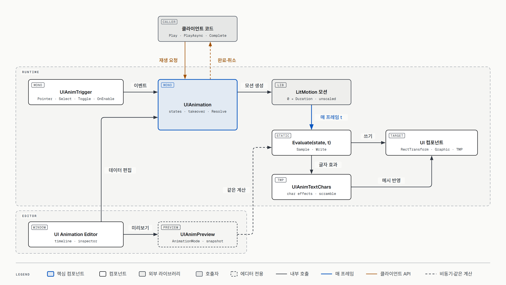
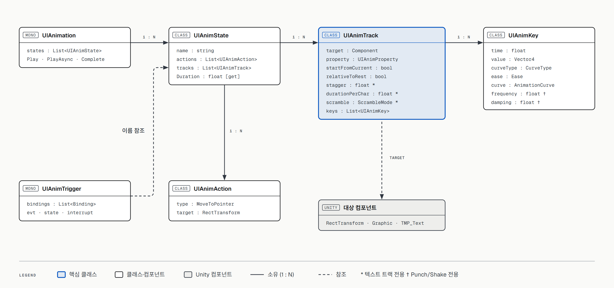

# UGUI Animation System — 설계 문서 (v3 · 구현 현황 반영)

> 상태: **구현 현황 기준 문서** · 2026-10-13 (`main` 8c7d737, PR #1 머지 시점)
> 대상: Unity 6000.6.3f1 · uGUI 2.x (TMP 내장) · LitMotion 2.0.2 · UniTask 2.5.11
> 방식: **완전 커스텀**. 데이터, 런타임, 에디터 창을 모두 직접 만듭니다. Animator와 Timeline은 사용하지 않습니다.
> 표기: ✅ 구현됨 · 🟡 일부 구현 · ⬜ 계획만 있음
> 도식 원본(HTML)은 [`diagrams/`](diagrams/)에 있습니다. 브라우저로 열면 벡터로 볼 수 있습니다.

---

## 0. 한눈에 보기

| # | 요구사항 | 상태 | 현재 구현 |
|---|---|---|---|
| R1 | Prefab 단위로 관리 | ✅ | 애니메이션 데이터가 Prefab 안의 `UIAnimation` 컴포넌트에 직렬화됩니다. 별도 asset이 없습니다 (§3) |
| R2 | 디자이너가 편하게 편집 | ✅ | UI Toolkit 기반 **UI Animation Editor** 창: 키프레임 타임라인, 속성 선택 창, 도착 방식 그래프 (§6) |
| R3 | 성능 | 🟡 | 재생 중인 상태만 LitMotion이 구동, 재생 대기는 풀링 소스 사용. **측정은 아직 안 함** (§4.6) |
| R4 | 이벤트별 편집 (Select·OnEnable·ValueChanged …) | ✅ | `UIAnimTrigger`: 이벤트 → 상태 (§5) |
| R5 | 공용 Prefab 중첩 (Button → Popup) | 🟡 | 중첩 자체는 동작합니다(Popup1 안의 Button1). 부모가 자식 상태를 시간축에서 호출하는 기능은 미구현 (§11) |
| R6 | 상위에서 하위 오버라이드 (현재 Prefab에서만) | ⬜ | 설계만 있음 (§11.1) |
| R7 | Scroll 애니메이션 | ⬜ | 설계만 있음 (§11.3) |
| R8 | Play 모드 없이 즉시 미리보기 | ✅ | 씬과 **Prefab 모드** 모두 지원. 정지·저장·Play 진입 시 원래 값으로 복원 (§6.4) |
| R9 | 클라이언트가 타이밍을 원활하게 호출 | ✅ | `PlayAsync`(UniTask)로 끝날 때까지 대기, `Complete`로 건너뛰기 (§7) |

---

## 1. 왜 커스텀인가

| | Animator | Timeline | **커스텀 (채택)** |
|---|---|---|---|
| 대기 중 비용 | 매 프레임 값을 기록 → Canvas dirty | 낮음 (Manual 구동 시) | **0** (재생 중일 때만 계산) |
| 바인딩 | 경로 문자열 | 트랙 객체 기준. asset을 교체하면 끊어짐 | **Prefab 내부 컴포넌트 직접 참조** |
| 중첩 자식을 부모 시간축에서 펼쳐 편집 | 불가 | Timeline 창 확장 한계 | **가능** (결정 이유) |
| 현재 Prefab에서만 자식 연출 오버라이드 | 불가 | 불가 | **가능** (결정 이유) |
| 개발 비용 | 낮음 | 낮음 | 높음. 편집기 제작이 대부분 |

### 참고 레포에서 가져온 것

| 레포 | 가져온 것 |
|---|---|
| [UGUIAnimationSamples](https://github.com/annulusgames/UGUIAnimationSamples) | **샘플 콘텐츠 목표** (`2_Button`, `4_Toggle`, `3_Text`). 같은 시간·이징·LitMotion 공식(Punch/Shake/Scramble)으로 재현 |
| [Unity-AnimationUI](https://github.com/DhafinFawwaz/Unity-AnimationUI) | 인스펙터 기반 편집과 슬라이더 미리보기 UX |
| [UnityScreenNavigator](https://github.com/Haruma-K/UnityScreenNavigator) | 화면 전환 계약(`Duration` + 시간 지정 재생) 참고. 도입하지 않음 |
| [UnityUIPlayables](https://github.com/Haruma-K/UnityUIPlayables) | 미리보기 후 값 복원 개념 |

---

## 2. 구조



[원본 HTML](diagrams/uianim-v3-architecture.html)

| 파일 | 역할 |
|---|---|
| `Runtime/UIAnimation.cs` | 데이터 정의(상태·트랙·키), 재생(`Play`/`PlayAsync`/`Complete`), 속성 인계, 값 계산(`Evaluate`), 속성 읽기/쓰기 |
| `Runtime/UIAnimTrigger.cs` | UI 이벤트 → 상태 재생 |
| `Runtime/UIAnimTextChars.cs` | TMP 글자별 효과 누적과 메시 반영, 스크램블 텍스트 |
| `Runtime/UIAnimVibration.cs` | LitMotion과 같은 Punch/Shake 공식, 시드 랜덤, 스크램블 문자열 생성 |
| `Editor/UIAnimationEditorWindow.cs` | UI Animation Editor 창 (상단 바, 상태 탭, 인스펙터) |
| `Editor/UIAnimTimelineView.cs` | 타임라인(도프시트): 눈금자, 트랙 줄, 키 다이아몬드, 선택·드래그 |
| `Editor/UIAnimPropertyPicker.cs` | 트랙 추가용 속성 선택 창 (오브젝트 트리 + 속성 카드 + 검색) |
| `Editor/UIAnimEaseGraph.cs` | 도착 방식 그래프 (읽기 전용) |
| `Editor/UIAnimPreview.cs` | Play 모드 없는 미리보기와 복원 |
| `Editor/UIAnimationInspector.cs` | `UIAnimation` 인스펙터에 "UI Animation Editor 열기" 버튼 |

런타임은 별도 "컴파일" 단계 없이 직렬화된 데이터를 그대로 평가합니다. 재생을 시작할 때 `Resolve`로 키 값을 한 번 확정하고(현재 값·원래 값 반영), 이후 매 프레임 `Evaluate(t)`만 실행합니다.

---

## 3. 데이터 모델



[원본 HTML](diagrams/uianim-v3-data-model.html)

```
UIAnimation : MonoBehaviour
 └─ states : List<UIAnimState>

UIAnimState  { name, actions: List<UIAnimAction>, tracks: List<UIAnimTrack> }
             // 길이(Duration) = 트랙 중 가장 늦게 끝나는 시간 (글자 지연 포함)

UIAnimTrack  { target: Component, property: UIAnimProperty,
               startFromCurrent, relativeToRest,
               stagger, durationPerChar, scramble,      // 텍스트 트랙 전용
               keys: List<UIAnimKey> }                  // 시간순

UIAnimKey    { time, value: Vector4,
               curveType: Ease | Curve | Punch | Shake,
               ease, curve: AnimationCurve,
               frequency, damping }                     // Punch/Shake 전용

UIAnimAction { type: MoveToPointer, target: RectTransform }
```

### 3.1 속성 (`UIAnimProperty`)

| 대상 | 속성 |
|---|---|
| Transform / RectTransform | `Scale`, `SizeDelta`, `AnchoredPosition` |
| Graphic (Image, TMP 등) | `GraphicColor`, `GraphicAlpha` |
| TMP_Text | `FontSize`, `TextReveal` (타자기, 0~1) |
| TMP_Text 글자별 | `CharScale`, `CharOffset`, `CharRotation`, `CharColor`, `CharAlpha` |

### 3.2 키프레임과 도착 방식
- Unity Animation 창처럼 트랙마다 키(시간, 값)를 찍습니다. 1 → 1.2 → 1은 키 3개입니다.
- 키의 도착 방식은 **이전 키에서 이 키로 오는 방식**입니다.
  - `Ease`: LitMotion Ease 프리셋
  - `Curve`: AnimationCurve. 0 = 이전 키 값, 1 = 이 키 값
  - `Punch`: 이전 값을 중심으로 흔들리다 이전 값으로 돌아옵니다. 키 값은 목적지가 아니라 **세기**입니다.
  - `Shake`: Punch와 같지만 축마다 매 프레임 무작위로 흔들립니다.
  - Punch/Shake의 감쇠 진동 공식과 랜덤은 LitMotion과 같습니다(`초당 진동 수`, `감쇠`).

### 3.3 트랙 옵션
- `startFromCurrent` (현재 값에서 시작)
  - **키가 2개 이상**: 첫 키가 재생 시작 순간의 값이 되고, 그 키 시간까지 유지됩니다. 첫 키를 0.025초에 두면 0.025초 지연이 됩니다(Toggle1).
  - **키가 1개**: "현재 값 → 이 키"로 이어집니다(호버/언호버, 팝업 Open/Close).
- `relativeToRest` (원래 값 기준): 키 값을 원래 값(Awake 시점, 미리보기는 시작 시점에 캡처)에 더합니다. 예: Button1 누를 때 크기 −(34, 17).

### 3.4 텍스트 트랙
- `TextReveal`: `maxVisibleCharacters`를 0~1 비율로 지정합니다. 리치 텍스트 태그는 글자 수에 포함하지 않습니다.
  - `scramble`: 아직 안 나온 글자를 무작위 문자로 채웁니다(LitMotion `ScrambleMode`). 원문의 공백은 유지해서 줄바꿈이 튀지 않습니다.
- 글자별 트랙(`Char*`)
  - 키는 **글자 하나의 움직임**입니다.
  - `stagger`(글자 간격): i번째 글자가 i × stagger초 늦게 시작합니다.
  - `durationPerChar`(글자당 길이): 0보다 크면 i번째 글자가 키 전체를 i × 이 값(초) 동안 재생합니다(Shake 샘플).
  - 같은 텍스트의 글자 트랙 여러 개(크기 + 위치 + 색 등)는 누적된 뒤 메시를 한 번만 갱신합니다.

---

## 4. 런타임 재생

### 4.1 재생 흐름
1. `Prepare`: 같은 상태가 재생 중이면 멈추고, 다른 상태와 겹치는 속성을 인계받고(§4.2), 액션을 실행하고, 키 값을 확정(`Resolve`)한 뒤 **0초 값을 바로 씁니다.**
2. LitMotion으로 0 → 길이 모션을 하나 만들고, 매 프레임 `Evaluate(state, t)`를 호출합니다. 상태 객체를 넘기는 static 바인딩이라 클로저 할당이 없습니다. 스케줄러는 `UpdateIgnoreTimeScale`입니다.
3. 끝에 도달하면 완료 처리합니다.

0초 값을 바로 쓰는 이유: 대사창처럼 text를 바꾸고 타자기를 재생하면, 그렇지 않을 때 새 대사가 한 프레임 동안 전부 보입니다.

### 4.2 속성 단위 인계
- 여러 상태가 동시에 재생될 수 있습니다. 새 상태는 **자기가 건드리는 속성만** 이전 상태에서 가져오고, 나머지는 계속 재생됩니다(Button2의 Hover와 Press).
- 중단 방식(`UIAnimInterrupt`)
  - `Cancel`: 겹치는 속성만 가져오고, 속성을 모두 잃은 상태는 멈춥니다.
  - `Complete`: 겹치는 상태를 끝 값으로 맞춘 뒤 시작합니다(Button2의 Down/Up).

### 4.3 완료와 취소


[원본 HTML](diagrams/uianim-v3-playback.html)

상태마다 "끝까지 감"과 "중간에 멈춤" 두 경로만 있습니다. 모든 정지 경로가 둘 중 하나를 거쳐서 대기 중인 Task가 걸려 있는 경우가 없습니다.

| 경우 | 결과 |
|---|---|
| 끝에 도달 | 완료 |
| `Complete(state)` 호출 | 끝 값으로 이동 후 완료 |
| 다른 상태가 `Complete` 인터럽트로 시작 | 끝 값으로 이동 후 완료 |
| 다른 상태가 속성을 모두 가져감 | 취소 |
| 같은 상태를 다시 재생 | 이전 재생은 취소 |
| 오브젝트 비활성화(`OnDisable`) | 취소 |
| `PlayAsync`에 넘긴 토큰 취소 | 멈추고 취소 |

### 4.4 텍스트
- 텍스트 속성을 쓰는 상태는 재생 시작 때 TMP 메시를 다시 만들어 글자 수를 새로 읽습니다. 그래서 text를 바꾼 뒤 재생하면 길이와 글자 간격이 새 텍스트 기준입니다.
- 스크램블은 text 자체를 바꾸므로 원문을 따로 기억합니다. 재생 중에 외부에서 text가 바뀌면 그것을 새 원문으로 씁니다.

### 4.5 액션
- `MoveToPointer`: 상태를 재생시킨 포인터 위치로 대상을 옮깁니다(Button2의 클릭 퍼짐).

### 4.6 성능 현황
| 항목 | 현재 |
|---|---|
| 대기 중 | 재생 중이 아닌 상태는 비용 0 (LitMotion 모션이 없음) |
| 재생 대기 | `PlayAsync`는 UniTask 풀링 소스(`AutoResetUniTaskCompletionSource`). `Play`는 대기 소스를 만들지 않음 |
| 글자 효과 | 텍스트당 프레임마다 메시 재생성 1회(`ForceMeshUpdate`). 많은 텍스트를 동시에 애니메이션하면 기본 정점 캐시가 필요할 수 있음 |
| 스크램블 | 공개 중에는 프레임마다 문자열 1개 생성 (TMP가 string을 요구) |
| 측정 | **미실측**. 버튼 100개 hover, 텍스트 다수 동시 재생에서 GC·ms 측정 예정 |

---

## 5. 이벤트 → 상태 (`UIAnimTrigger`)

| 이벤트 | 출처 |
|---|---|
| `OnEnable` | 컴포넌트 활성화 |
| `PointerEnter` / `PointerExit` / `PointerDown` / `PointerUp` / `Click` | `IPointer*Handler` |
| `Select` / `Deselect` | `ISelectHandler` / `IDeselectHandler` |
| `ToggleOn` / `ToggleOff` | `Toggle.onValueChanged` |

- 항목마다 `{이벤트, 상태 이름, 중단 방식}`을 지정합니다.
- 상호작용 불가(`interactable = false`)인 Selectable은 입력 이벤트를 무시합니다. `OnEnable`은 그래도 재생합니다.
- UnityEvent(예: Button.onClick)에서는 `PlayState(string)`을 연결합니다.

---

## 6. 에디터 — UI Animation Editor

`Window/UI Animation Editor` 메뉴 또는 `UIAnimation` 인스펙터의 **UI Animation Editor 열기** 버튼으로 엽니다. 선택한 오브젝트(또는 부모)의 `UIAnimation`을 편집합니다.

### 6.1 창 구성
| 영역 | 내용 |
|---|---|
| 상단 바 | 재생/정지/반복, 속도(0.1x~1x), 현재 시간/전체 길이, 미리보기 상태 표시 |
| 상태 탭 | 상태 선택·추가 |
| 타임라인 (왼쪽) | 트랙 줄(대상 경로 + 속성 이름, 속성별 색), 키 다이아몬드, 눈금자 클릭·드래그로 시간 이동 |
| 인스펙터 (오른쪽) | Unity 인스펙터 형식의 접는 섹션: 상태 / 트랙 / 키 / 도착 방식 |

### 6.2 타임라인 편집
- 키 선택: 클릭, Shift/Ctrl 클릭, 박스 선택. 여러 키를 함께 드래그, Delete로 삭제.
- 키 추가: 트랙의 ◆ 버튼(현재 시간에 추가), 오른쪽 클릭 메뉴.
- 트랙 추가: **속성 선택 창**에서 Prefab 안 오브젝트를 고르고 속성 카드(현재 값 미리보기 포함)를 클릭합니다. 검색 가능.
- 눈금 간격은 확대 정도에 따라 자동으로 바뀝니다(0.05~10초).
- 글자 트랙은 마지막 키 뒤에 **연한 막대**로 뒤 글자들이 더 재생되는 구간을 보여 줍니다. 마우스를 올리면 툴팁으로 늘어난 시간과 줄이는 방법을 알려 줍니다.

### 6.3 인스펙터
- 상태: 이름, 시작 시 동작(액션)
- 트랙: 대상 변경, 현재 값에서 시작, 원래 값 기준. 텍스트 트랙은 글자 간격·글자당 길이 또는 스크램블
- 키: 시간, 값(Punch/Shake는 "세기"), 현재 값 캡처 버튼. 여러 키를 선택하면 공통 값만 편집
- 도착 방식: 방식, Ease, 초당 진동 수·감쇠(Punch/Shake), AnimationCurve, **읽기 전용 그래프**
- 모든 편집은 Unity Undo로 되돌릴 수 있습니다.

### 6.4 Play 모드 없는 미리보기
- 런타임과 **같은 `Evaluate`**를 씁니다. 그래서 미리보기와 실제 재생 결과가 같습니다.
- **씬**: 바뀌는 속성을 `AnimationMode`에 등록하고, 값은 샘플링 블록 밖에서 씁니다. 블록을 닫을 때(`EndSampling`) 등록된 속성이 원래 값으로 되돌아가기 때문입니다. 등록만으로도 값이 저장되지 않고, 정지하면 복원됩니다.
- **Prefab 모드**: Scene 뷰가 샘플링 블록 밖에서 쓴 값을 다시 그리지 않아서, 속성을 등록하지 않고 블록 안에서 씁니다. 복원은 시작 시점의 스냅샷으로 합니다.
  - 미리보기 후 Prefab에 '수정됨'(`*`) 표시가 생깁니다. 값은 정확히 복원되므로 저장해도 내용은 같습니다. 값을 건드렸다는 신호로 그대로 둡니다.
- **시작 상태 자동 결정**: 어떤 상태는 다른 상태가 끝난 모습에서 시작해야 움직임이 보입니다.
  1. 트리거 이벤트 짝: Exit←Enter, Up←Down, Deselect←Select, ToggleOff←ToggleOn
  2. 이름 짝 (트리거 없이 코드로 재생하는 상태): Open↔Close, Show↔Hide, In↔Out
- **자동 정지·복원 시점**: 정지 버튼, 다른 `UIAnimation` 선택, 씬/Prefab 저장 직전, 씬 닫기·되돌리기, Play 모드 진입, 스크립트 리로드, 창 닫기.
- 스크램블로 바뀐 text와 글자 효과(메시)도 복원합니다.

---

## 7. 클라이언트 API

```csharp
public sealed class UIAnimation : MonoBehaviour
{
    public void Play(string stateName, UIAnimInterrupt interrupt = UIAnimInterrupt.Cancel,
                     PointerEventData pointer = null);
    public UniTask PlayAsync(string stateName, UIAnimInterrupt interrupt = UIAnimInterrupt.Cancel,
                             CancellationToken cancellationToken = default);
    public void Complete(string stateName);   // 재생 중인 상태를 끝으로 건너뛰기
    public bool IsPlaying(string stateName);
    public void PlayState(string stateName);  // UnityEvent 연결용
}
```

**팝업 닫기** — 닫히는 도중 다시 열리면 Destroy하지 않습니다.
```csharp
var canceled = await popup.PlayAsync("Close", cancellationToken: popup.destroyCancellationToken)
    .SuppressCancellationThrow();
if (canceled) return;          // Open이 Close를 가져감 → 팝업 유지
Destroy(popup.gameObject);
```

**대사창** — 같은 TMP의 text를 바꿔 가며 재생하고, 스킵은 `Complete`.
```csharp
dialogue.text = nextLine;
var typing = anim.PlayAsync("Typewriter");
// 스킵 버튼: anim.Complete("Typewriter");
await typing;
```

**정책**
- 끝나지 않은 재생은 **취소(OperationCanceledException)**로 끝납니다. "끝나야만 다음 동작"이 기본이 되도록 하기 위해서입니다. 예외 없이 받으려면 `SuppressCancellationThrow()`를 씁니다.
- 상태는 문자열 이름으로 지정합니다. 없는 이름은 경고 로그를 남기고 무시합니다.

---

## 8. 샘플 콘텐츠 (개발용, 배포 안 됨)

모두 `Assets/Editor/SampleContentBuilder.cs`가 코드로 생성합니다. 메뉴: `Tools/UIAnimation Dev/Rebuild Sample …`. 모든 씬의 Canvas 기준 해상도는 **1920×1080**입니다.

| 씬 | 프리팹 | 상태 | 참고 원본 |
|---|---|---|---|
| `Buttons` | Button1 | Hover/Unhover(색), Press/Release(크기·글자 크기 축소) | `2_Button` Button_1 |
| | Button2 | Hover/Unhover(오버레이), Press(포인터 위치에서 원 퍼짐)/Release | `2_Button` Button_2 |
| `Toggles` | Toggle1 | On(체크 → 0.025초 뒤 채우기)/Off(역순) | `4_Toggle` Toggle_1 |
| | Toggle2 | On/Off(손잡이 이동 + 채우기) | `4_Toggle` Toggle_2 |
| `Text` | TextDemo | Typewriter, Scramble, Flip, PopUp, Punch, Shake | `3_Text` Animation1~6 |
| `Popup` | Popup1 (+ 공용 Button1 중첩) | Open/Close, `PopupSample`로 Close 후 Destroy, 도중 취소 시 유지 | — |

- 생성 규칙: 프리팹은 같은 경로에 다시 저장해서 GUID를 유지합니다. 씬은 파일이 없을 때만 만들고, 열려 있는 씬은 덮어쓰지 않습니다.
- `PopupSample`의 `Close>Open` 버튼은 닫기 0.15초 뒤에 다시 열어 취소 상황을 재현합니다. `pauseOnReopen`을 켜면 그 순간 에디터가 멈춰 프레임 단위로 볼 수 있습니다.

---

## 9. 테스트와 CI

### 9.1 EditMode 테스트 (26개, 메서드 이름은 한국어)
| 파일 | 개수 | 다루는 것 |
|---|---|---|
| `UIAnimationTests.cs` | 15 | 키 보간, 현재 값 시작·지연, 원래 값 기준, Ease, 속성 인계(Cancel/Complete), **완료 대기·취소 7종** |
| `UIAnimationTextTests.cs` | 11 | 공개 비율, 글자 간격 길이, 글자 크기, Punch, 스크램블(길이·공백·원문 복원), **대사창 텍스트 교체 5종** |

### 9.2 CI
- GitHub Actions + **self-hosted Linux 러너**(`self-hosted, linux, unity`)에서 Unity CLI로 EditMode 테스트를 실행합니다. 설정 방법은 [`CI-SelfHostedRunner.md`](CI-SelfHostedRunner.md).
  - Unity Personal 라이선스는 Hub 로그인으로만 활성화되어 GameCI(`.ulf` 필요)를 쓸 수 없기 때문입니다.
- `main` 보호 규칙: "Unity EditMode Tests" 통과 필수(최신 main 기준), 관리자 포함, 강제 push·삭제 금지.
- 저장소 설정: 자동 머지 허용, 머지 후 브랜치 자동 삭제.

---

## 10. 폴더와 배포

레포는 **개발용 Unity 프로젝트**이고, 배포 대상은 `package.json`이 있는 `Assets/UIAnimation/` 하나입니다.

```
Assets/
  UIAnimation/                              ← 배포 대상 (com.seobyp.timelineanimation 0.0.1)
    Runtime/      (asmdef SeoBYP.TimelineAnimation)
    Editor/       (asmdef SeoBYP.TimelineAnimation.Editor)
    Tests/Editor/ (asmdef SeoBYP.TimelineAnimation.Tests.Editor)
  Editor/SampleContentBuilder.cs            ← 샘플 생성기 (개발용)
  Scripts/PopupSample.cs                    ← 샘플 스크립트 (개발용)
  Prefabs/  Scenes/  Textures/  Fonts/      ← 샘플 리소스 (개발용)
Docs/                                       ← 문서 (배포 안 됨)
```

- **배포 경계**: `Assets/UIAnimation` 안의 코드는 샘플을 참조하지 않습니다(asmdef로 분리).
- **의존성**: LitMotion·UniTask는 Unity 공식 레지스트리에 없어서, 설치하는 쪽이 Git URL이나 OpenUPM으로 추가해야 합니다.
- **배포 절차 (예정)**: 직접 써 본 뒤 `0.1.0`으로 올리고 태그를 붙입니다.
  ```
  https://github.com/SeoBYP/UGUITimelineAnimation.git?path=Assets/UIAnimation#v0.1.0
  ```

---

## 11. 진행 현황과 다음 단계

진행 방식은 **콘텐츠 주도**입니다. 실제 UI를 하나씩 만들면서 그 콘텐츠에 필요한 기능만 추가합니다. 기능마다 브랜치를 만들고 PR로 머지합니다.

| 단계 | 콘텐츠 | 상태 | 추가한 기능 |
|---|---|---|---|
| P0 | — | ✅ | 패키지 뼈대, LitMotion·UniTask |
| M1 | 샘플 버튼 | ✅ | 런타임 코어, 이벤트 트리거, 속성 인계, MoveToPointer |
| M2 | 버튼 편집 | ✅ | UI Animation Editor, 키프레임 모델, 미리보기 |
| M4 | 토글 | ✅ | On/Off, 시작 상태 자동 결정 |
| M6 일부 | 텍스트 | ✅ | TMP 글자별 애니메이션, 타자기·스크램블, Punch/Shake |
| M5 일부 | 팝업 | 🟡 | `PlayAsync`/`Complete`, Prefab 모드 미리보기. 오버라이드·자식 호출·Signal은 미구현 |
| M3 | Hover 6종 (`1_Hover`) | ⬜ | `FillAmount` 등 부족한 속성 |
| M6 나머지 | 스크롤 리스트 | ⬜ | 보이는 아이템만 stagger, 스크롤 스크럽, **성능 첫 측정** |

### 11.1 ⬜ 현재 Prefab에서만 동작하는 오버라이드 (R6)


> **오버라이드는 그것을 만든 Prefab 안에서만 동작한다. 원본 Prefab의 애니메이션은 절대 수정되지 않는다.**

- 저장 위치: 자식 인스턴스의 필드(Unity Prefab override)가 아니라 **바깥 Prefab 자신의 `UIAnimation`**에 `{자식 참조, 상태 이름, 교체 상태 복사본}`으로 저장합니다. 그래서 "Apply to Prefab"으로 원본에 실수로 반영되는 경로가 없습니다.
- 편집: 중첩 인스턴스의 원본 상태는 읽기 전용으로 보이고, `[이 Prefab에서 오버라이드]`를 누르면 복사본을 만들어 그것만 편집합니다. `[되돌리기]`는 복사본만 삭제합니다.
- 해석: 가장 바깥 Prefab이 이깁니다. 재생 시작 시 부모 방향으로 오버라이드를 찾습니다.
- 검증: 오버라이드 생성·편집 후 원본 Prefab 파일 해시가 변하지 않는지 자동 테스트로 고정합니다.

### 11.2 ⬜ 부모가 자식 상태를 호출 (R5)
- 부모 상태에 자식 호출 트랙(`{자식, 상태, 시작 시간}`)을 넣습니다. 에디터에서 펼치면 자식 트랙이 부모 시간축에 보입니다.
- Signal 마커: 디자이너가 찍은 시점에 이벤트(효과음 등)를 받습니다.

### 11.3 ⬜ Scroll 애니메이션 (R7)
| 패턴 | 예시 | 구동 |
|---|---|---|
| 진입 stagger | 리스트를 열 때 아이템이 차례로 등장 | 보이는 아이템만 재생, 화면 밖은 즉시 끝 상태 |
| 가시성 이벤트 | 새로 보이는 아이템 fade-in | 스크롤 값이 바뀔 때만 가시성 계산 |
| 위치 스크럽 | 접히는 헤더, 캐러셀 중앙 확대 | 스크롤 값 → 상태의 시간 지정 (시간 지정 API 필요) |

---

## 12. 열린 검증 항목
- [x] Prefab 모드에서 미리보기 동작과 복원 — 샘플링 블록 방식으로 해결 (§6.4)
- [ ] 바깥 Prefab이 중첩 인스턴스 내부 컴포넌트를 참조할 때, 원본 구조가 바뀌어도 참조가 유지되는지
- [ ] 오버라이드 생성·편집 후 원본 Prefab 파일 해시 불변 (자동 테스트)
- [ ] 버튼 100개 hover, 텍스트 다수 동시 재생, 스크롤 리스트 50개에서 GC·ms 측정
- [ ] Play 모드에서 `PlayAsync`가 실제 LitMotion 완료로 풀리는 경로의 자동 테스트 (현재는 PlayMode 수동 확인만)

---

## 부록: 초기 설계 도식

아래는 구현 전에 그린 도식입니다. 실제 구현과 다른 부분이 있습니다. 예를 들어 런타임에는 `CompiledState`·전역 러너가 없고 키프레임 모델을 직접 평가하며, 에디터 화면도 목업과 다릅니다.

- [시스템 구조](diagrams/uianim-architecture.png) · [데이터 모델](diagrams/uianim-data-model.png) · [재생 흐름](diagrams/uianim-play-sequence.png) · [에디터 목업](diagrams/uianim-editor-mockups.png)
- HTML 원본: [`diagrams/`](diagrams/)
