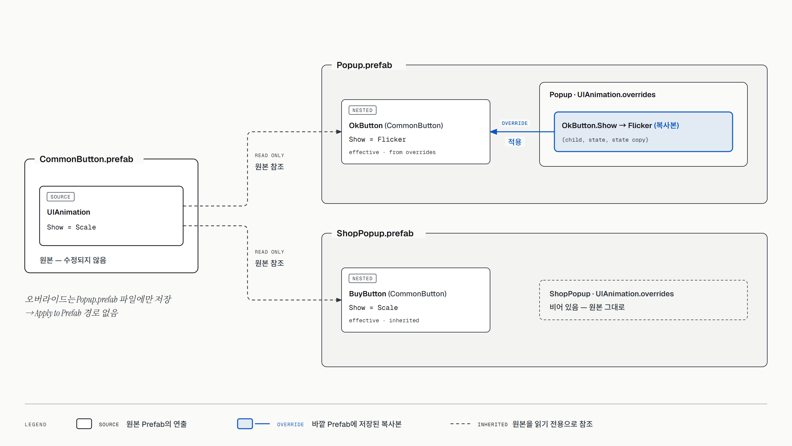
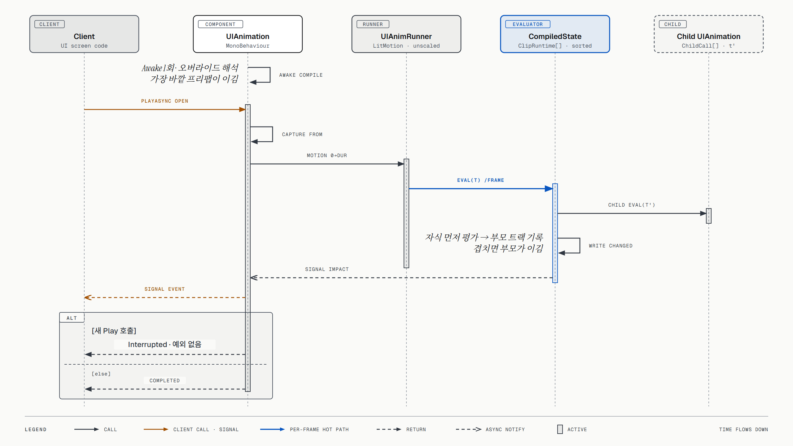
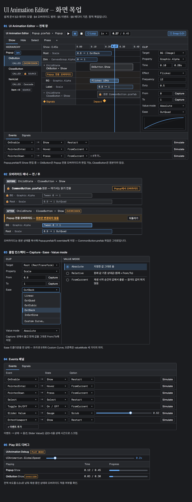

# UGUI Animation System — 설계 문서 (v2 · 커스텀)

> 상태: 설계 초안 · 2026-10-13
> 대상: Unity 6000.6.3f1 · uGUI 2.6.0 (TMP 내장) · LitMotion · UniTask
> 방식: **완전 커스텀** — 데이터, 런타임 evaluator, 에디터 창을 모두 직접 만듭니다. Animator와 Timeline은 사용하지 않습니다.
> 도식 원본(HTML)은 [`diagrams/`](diagrams/)에 있습니다. 브라우저로 열면 벡터로 볼 수 있습니다.

---

## 0. 요구사항

| # | 요구사항 | 설계 대응 |
|---|---|---|
| R1 | Prefab 단위로 관리 | 애니메이션 데이터가 **Prefab 안의 컴포넌트에 직렬화**됨. 별도 asset이 필요 없음 (§3) |
| R2 | 디자이너가 편하게 편집 | 전용 **UI Animation Editor** 창: 시간축, 클립, 캡처, 즉시 프리뷰 (§8) |
| R3 | 성능 최적화 | 그래프 없는 평탄 배열 evaluator + 전역 러너 1개, 프레임당 할당 0 목표 (§7) |
| R4 | Select·OnEnable·ValueChanged 등 이벤트별 편집 | `UIAnimTrigger`: 이벤트 → 상태 (§5) |
| R5 | 공용 Prefab 중첩 (Button → Popup) | 부모는 자식 상태를 `ChildState` 트랙으로 **호출** (§4) |
| R6 | 상위에서 하위 오버라이드 | **현재 Prefab 안에서만 적용. 원본 Prefab은 절대 수정하지 않음** (§4) |
| R7 | Scroll 애니메이션 | 진입 stagger / 가시성 이벤트 / 위치 스크럽 (§6) |
| R8 | Play 모드 없이 즉시 프리뷰 | 에디터 창에서 항상 라이브 프리뷰, 끝나면 자동 복원 (§8.3) |
| R9 | 클라이언트가 타이밍을 원활하게 호출 | `PlayAsync` / Signal / 스크럽 API (§9) |

### 범위에서 제외한 것
- **화면 스택(Page/Modal/Sheet)**: UnityScreenNavigator는 도입하지 않고, 전환 계약(`Duration` + `SetTime`)만 따릅니다.
- **스크롤 스냅/페이징**: 애니메이션 시스템이 아닌 스크롤 동작이라 제외합니다.

---

## 1. 왜 커스텀인가

| | Animator | Timeline | **커스텀 (채택)** |
|---|---|---|---|
| idle 비용 | 매 프레임 값을 기록 → Canvas dirty | 낮음 (Manual 구동 시) | **0** (재생 중일 때만 계산) |
| 런타임 구조 | 상태 머신 | 인스턴스마다 PlayableGraph | 평탄 배열 + 러너 1개 |
| 바인딩 | 경로 문자열 | 트랙 객체 기준. asset을 교체하면 끊어짐 | **Prefab 내부 직접 참조** |
| 부모-자식 평가 순서 | 레이어 | 문서상 보장 안 됨 | **직접 보장** |
| 중첩 자식을 부모 시간축에서 펼쳐 편집 | 불가 | Timeline 창 확장 한계 | **가능** (결정 이유) |
| 개발 비용 | 낮음 | 낮음 | **높음**. 편집기 제작이 대부분 |

결정 이유는 두 가지입니다.
- "중첩된 자식 연출을 부모 시간축 안에서 펼쳐 보고, 현재 Prefab에서만 오버라이드"가 필수 요구입니다.
- 이것은 기존 도구로는 구조적으로 만들 수 없습니다.

### 참고 레포에서 가져온 것

| 레포 | 가져온 것 |
|---|---|
| [UGUIAnimationSamples](https://github.com/annulusgames/UGUIAnimationSamples) | **마일스톤의 목표 콘텐츠**(`2_Button` → `1_Hover` → `4_Toggle` → `3_Text`). 중단 후 현재 값부터 재시작(`FromCurrent`), TMP 글자 단위 연출, LitMotion 사용 패턴 |
| [Unity-AnimationUI](https://github.com/DhafinFawwaz/Unity-AnimationUI) | 인스펙터 기반 시퀀스 편집과 슬라이더 프리뷰 UX. 코루틴 구조는 버림 (seek 불가, 역재생 시 원본 배열을 변형하는 버그) |
| [UnityScreenNavigator](https://github.com/Haruma-K/UnityScreenNavigator) | `Duration` + `SetTime(t)` seek 계약 |
| [UnityUIPlayables](https://github.com/Haruma-K/UnityUIPlayables) | 컴포넌트별 속성 Mixer 분리, 프리뷰 후 값 복원 개념. 매 프레임 할당하는 문제는 버림 |

---

## 2. 전체 구조


[원본 HTML](diagrams/uianim-architecture.html)

| 구성 요소 | 책임 |
|---|---|
| `UIAnimation` (컴포넌트) | 상태 목록, 자식 오버라이드 목록 보유. 재생 API, `SetTime` 계약 |
| `UIAnimTrigger` | UI 이벤트 → 상태 매핑 |
| `UIAnimScroll` | ScrollRect 가시성 이벤트, 스크롤 값 스크럽 |
| `CompiledState` | Awake 시점에 오버라이드를 반영해서 만든 **평탄 struct 배열** (런타임 전용) |
| `UIAnimRunner` | 전역 러너 1개. LitMotion 스케줄러로 재생 중인 상태만 진행 |
| `PropertyWriter` | 속성별 쓰기 (RectTransform / CanvasGroup / Graphic / Image / TMP). 리플렉션 없음 |
| UI Animation Editor | 전용 편집 창 (UI Toolkit) + 라이브 프리뷰 |

---

## 3. 데이터 모델


[원본 HTML](diagrams/uianim-data-model.html) · 도식은 핵심 7개 클래스만 표시합니다(`SignalTrack`, `UIAnimPreset` 생략). 전체 정의는 아래 코드 블록을 보세요.

```
UIAnimation : MonoBehaviour
 ├─ states : List<UIAnimState>              ← 이 Prefab이 소유한 연출
 └─ overrides : List<UIAnimOverride>        ← 이 Prefab 안에서만 유효한 자식 오버라이드

UIAnimState      { name, actions[], tracks[] }                  // duration = 가장 늦은 키의 시간
UIAnimTrack      { target: Component, property, startFromCurrent, relativeToRest, keys[] }   // 속성 트랙 (M1~M2)
UIAnimKey        { time, value, ease | curve }                  // ease/curve = 이전 키에서 "이 키에 도착하는" 방식
  (예정) ChildStateTrack { child: UIAnimation, state, start }    // M5
  (예정) SignalTrack     { markers[] (time, id) }                // M5
UIAnimOverride   { child: UIAnimation, state, replacement: UIAnimState (인라인 복사본) }
UIAnimPreset : ScriptableObject   { states[] }   // 선택: 라이브러리 재사용용. 적용 시 Prefab 안에 "복사"됨
```

**필드 설명**
- `property`
  - RectTransform: `AnchoredPosition` · `Scale` · `RotationZ` · `SizeDelta`(경고)
  - CanvasGroup: `Alpha`
  - Graphic: `Color` · `Alpha`
  - Image: `FillAmount`
  - TMP: `CharReveal` · `CharOffset` (P4)
  - GameObject: `Active`
- **키프레임 방식 (M2에서 변경)**: Unity Animation 창처럼 트랙마다 키(시간, 값)를 찍습니다. 1 → 1.2 → 1은 키 3개입니다.
  - 처음에는 From / To / 곡선 세 가지로 값을 정하는 방식이었습니다. 그런데 화면에서 실제 결과를 읽기 어려워서 키프레임으로 바꿨습니다.
  - 키의 Ease 또는 AnimationCurve는 **이전 키에서 이 키로 도착하는 방식**입니다. 커브 값 0 = 이전 키의 값, 1 = 이 키의 값입니다.
- **트랙 옵션 2개**
  - `startFromCurrent` (현재 값에서 시작): 재생을 시작하는 순간의 값에서 출발합니다.
    - **키가 2개 이상**: 첫 키가 재생 시작 순간의 값이 되고, 그 키의 시간까지 값을 유지합니다. 첫 키를 0.025초에 두면 0.025초 딜레이가 됩니다(Toggle1 샘플).
    - **키가 1개**: "현재 값 → 이 키"로 이어집니다(호버/언호버).
  - `relativeToRest` (원래 값 기준): 키 값을 원래 값(Awake 시점에 캡처)에 더합니다. 예: Button1의 −14.
- `effect`
  - `Tween`
  - `Flicker`: 빈도와 duty 지정
  - `Shake`, `Punch`: LitMotion의 shake/punch 계산 사용
  - `Step`: 끝 시점에 한 번만 설정
- **참조 방식**: 트랙은 **Prefab 내부 컴포넌트를 직접 참조**합니다. 데이터가 Prefab 안에 있으므로 이름(슬롯)으로 간접 참조할 필요가 없습니다.
- **프리셋**: 공용 연출 라이브러리입니다. "적용"하면 Prefab 안으로 **복사**됩니다. 그래서 프리셋을 나중에 수정해도 이미 적용한 Prefab은 바뀌지 않습니다. 의도한 분리입니다. 프리셋은 대상 역할 이름(`Root`, `Label` 등)으로 저장되고, 복사할 때 자동 매칭합니다.

---

## 4. Prefab 관리와 오버라이드 범위



[원본 HTML](diagrams/uianim-override-scope.html)

### 4.1 규칙
> **오버라이드는 그것을 만든 Prefab 안에서만 동작한다. 원본 Prefab의 애니메이션은 절대 수정되지 않는다.**

예시:
- `CommonButton.prefab`의 `Show` = **Scale**
- `Popup.prefab` 안의 OkButton에서 `Show`를 **Flicker**로 오버라이드
  - 결과: 이 Popup의 OkButton만 Flicker
  - `CommonButton.prefab` 원본: 여전히 Scale
  - 다른 `ShopPopup.prefab` 안의 CommonButton: 여전히 Scale

### 4.2 저장 위치가 규칙을 보장한다
- 오버라이드는 자식 인스턴스의 필드를 바꾸는 방식(Unity Prefab override)이 **아닙니다**.
- 대신 **바깥 Prefab 자신의 `UIAnimation.overrides`**에 `{child 참조, state, 교체 상태 복사본}`으로 저장합니다.
  - 자식 인스턴스에는 수정 사항이 하나도 생기지 않습니다.
  - 그래서 Unity의 "Apply to Prefab"으로 원본에 실수로 반영되는 경로가 **원천적으로 없습니다**.
  - 오버라이드 데이터는 Popup.prefab 파일 안에만 존재합니다.
- 에디터는 중첩 인스턴스의 원본 상태를 **읽기 전용**으로 표시합니다.
  - 편집하려고 하면 `[Popup에서 오버라이드]` 버튼이 나옵니다.
  - 누르면 원본 상태를 **복사해서**(copy-on-write) Popup의 overrides에 넣고, 그 복사본만 편집합니다.
  - `[되돌리기]`를 누르면 오버라이드 항목만 삭제되고 원본 연출로 돌아갑니다.
- 원본 자체를 바꾸고 싶으면 `CommonButton.prefab`을 직접 열어서 편집합니다. 이 경우 오버라이드하지 않은 모든 사용처에 반영됩니다.

### 4.3 해석 규칙
- **가장 바깥 Prefab이 이긴다**:
  - 예: `Window ▸ Popup ▸ OkButton`
  - Window와 Popup이 둘 다 OkButton.Show를 오버라이드하면, Window 안에서는 Window의 것이 쓰입니다.
  - Popup.prefab을 단독으로 열면 Popup의 것이 쓰입니다.
- **해석 시점**: Awake에서 부모 방향으로 `UIAnimation`을 훑어서 오버라이드를 수집한 뒤 `CompiledState`를 만듭니다. **재생 중 비용은 0**입니다.
- **원본 구조 변경 감지**: 원본 Prefab에서 자식이 삭제되는 등 참조가 끊기면 Validator가 경고하고, 런타임은 원본 연출로 대체합니다.

### 4.4 부모가 자식을 호출하기
- 부모 상태에 **`ChildState` 트랙**을 넣으면 `{child, state, start}`를 지정한 시점에 자식 상태가 재생됩니다.
- 에디터에서는 이 트랙을 펼치면 자식 트랙이 부모 시간축 위에 그대로 보입니다.
  - 원본 연출은 잠금 표시와 함께 보입니다.
  - 오버라이드한 연출은 편집 가능하게 보입니다.
- `Cascade` 옵션을 켜면 트랙 없이도 부모 Show 시 자식 Show를 hierarchy 순서대로 `interval × index` 간격을 주어 재생합니다.
- **평가 순서는 고정**입니다:
  1. 부모의 `ChildState` 트랙이 먼저 자식을 평가합니다.
  2. 그 다음 부모의 `PropertyTrack`이 적용됩니다.
  - 그래서 같은 속성을 쓰면 **부모가 이깁니다**.

---

## 5. 이벤트 → 상태 (`UIAnimTrigger`)

| 이벤트 | 비고 |
|---|---|
| OnEnable, Show/Hide(API) | Hide는 `await HideAsync()` 후 `SetActive(false)`로 처리. 이미 꺼진 오브젝트에서는 재생할 수 없기 때문 |
| Select / Deselect, Submit | `ISelectHandler` 등 |
| PointerEnter / Exit / Down / Up, Click | `IPointer*Handler` |
| Toggle On / Off | `Toggle.onValueChanged` |
| Slider / Scrollbar Value | **스크럽**: 값(0~1) → 상태 내 시간 |
| Interactable 변경 | Unity에 이벤트가 없음 → 러너에서 변화 감지. ⚠️ 비용 측정 필요 |
| EnterViewport / ExitViewport | `UIAnimScroll`이 발생시킴 |

트리거 항목마다 옵션 `Restart` / `FromCurrent` / `Reverse`를 고릅니다. 트리거 목록도 Prefab에 저장되고, 에디터 창의 Events 패널에서 편집합니다.

---

## 6. Scroll 애니메이션

| 패턴 | 예시 | 구동 |
|---|---|---|
| 진입 stagger | 리스트를 열 때 아이템이 차례로 등장 | **viewport 안에 보이는 아이템만** Cascade 재생. 화면 밖은 즉시 끝 상태 |
| 가시성 이벤트 | 새로 보이는 아이템 fade-in, 풀링 재사용 | `onValueChanged`에서만 가시성 계산(매 프레임 X) → `EnterViewport` |
| 위치 스크럽 | 접히는 헤더, 캐러셀 중앙 확대, 패럴랙스 | 스크롤 값 → `SetTime`. 캐러셀은 아이템별 viewport 내 상대 위치(0~1) 사용 |

- 위치 스크럽은 Slider 스크럽과 **같은 코드 경로**입니다.
- ⚠️ 미실측: 스크롤 리배치와 애니메이션이 겹칩니다. Validator가 `Viewport에 Canvas 없음`, `LayoutGroup 하위 SizeDelta`를 경고합니다.

---

## 7. 런타임



[원본 HTML](diagrams/uianim-play-sequence.html)

### 7.1 컴파일 (Awake 1회)
상태마다 오버라이드를 반영해서 `CompiledState`를 만듭니다.
- `ClipRuntime[]`
  - 내용: `start, duration, writerIndex, property, from, to, ease, curveIndex, valueMode, effect`
  - 시작 시간순으로 정렬한 struct 배열입니다.
- `PropertyWriter[]`: 대상 컴포넌트 참조를 캐시합니다. `GetComponent`는 이 시점에만 호출합니다.
- `ChildCall[]`: 자식 `UIAnimation` 참조와 시간 매핑입니다.

### 7.2 재생
- `Play` 시 LitMotion으로 모션을 하나 만듭니다: `LMotion.Create(0, duration)` + `Bind(state, static ...)`.
  - 상태를 넘기는 바인딩이라 클로저 할당이 없습니다.
  - 스케줄러 기본값은 unscaled입니다.
- `Evaluate(t)`가 하는 일:
  1. `ChildCall` 평가
  2. 활성 클립마다 ease/effect를 적용하고 lerp한 뒤 write
  3. Signal 통과 여부 검사
- **변화가 없는 속성은 쓰지 않습니다**. 클립이 비활성이 되면 끝값을 한 번 쓰고 멈춥니다. Canvas dirty를 최소화하기 위해서입니다.
- `FromCurrent` 클립은 Play 시점에 현재 값을 캡처합니다.

### 7.3 성능 방침

| 항목 | 방침 |
|---|---|
| idle | 재생 중이 아니면 비용 0 (러너에 등록되지 않음) |
| 할당 | 컴파일 이후 프레임당 0B 목표. `PlayAsync`는 풀링된 UniTask source 사용 |
| 쓰기 | 페이드는 `CanvasGroup.Alpha`, 크기는 `Scale` 우선. `SizeDelta`는 레이아웃 리빌드라 경고 |
| Canvas | 애니메이션되는 요소는 sub-canvas 권장 (Validator) |
| 측정 | Profiler + Performance Testing. 버튼 100개 hover, 스크롤 리스트 50개 — **미실측, P5에서 측정** |

---

## 8. 에디터 — UI Animation Editor



[원본 HTML](diagrams/uianim-editor-mockups.html) · 화면별: [전체 창](diagrams/uianim-editor-window.png) · [오버라이드 배너](diagrams/uianim-editor-override.png) · [클립 인스펙터](diagrams/uianim-editor-clip.png) · [Events](diagrams/uianim-editor-events.png) · [디버그](diagrams/uianim-editor-debug.png)

### 8.1 창 구성

| 영역 | 내용 |
|---|---|
| 툴바 | Prefab 경로(`Popup ▸ OkButton`), 상태 탭(Show / Hide / Select …), 재생·정지·루프·속도, 현재 시간, 스냅 |
| 왼쪽: 계층 | 현재 Prefab의 `UIAnimation` 트리. 배지 `OWN` / `CALLED` / `OVERRIDDEN` / `SOURCE(잠김)` |
| 가운데: 시간축 | 트랙과 클립. `ChildState` 트랙을 펼치면 자식 트랙이 표시됨. 원본은 잠금, 오버라이드는 편집 가능 |
| 오른쪽: 클립 인스펙터 | 대상·속성, From/To + **캡처**(씬에서 옮긴 값을 그대로 저장), ease 드롭다운과 커브 미리보기, effect 파라미터, valueMode |
| 아래: Events / Signals | 트리거 목록(이벤트 → 상태 → 옵션, `Simulate`), Signal 마커 목록 |
| 오버라이드 배너 | 원본 상태를 선택하면 "CommonButton.prefab 원본 — [Popup에서 오버라이드]". 오버라이드 중이면 "Popup 전용 — [되돌리기]" |

### 8.2 MVP 범위 (P3)
**MVP에 넣는 것**
- 트랙과 클립의 추가/삭제/이동/트림, 스냅
- 복사/붙여넣기
- Undo: `SerializedObject` 기반이라 Unity Undo를 그대로 사용
- From/To 캡처, ease 프리셋 + `CurveField`
- `ChildState` 펼쳐 보기, 오버라이드 생성/되돌리기
- Events 패널, Signal 마커
- 라이브 프리뷰(스크럽·재생·루프·속도)

**MVP 이후**
- 박스 다중 선택
- 키프레임 녹화 모드
- 전용 커브 그래프 편집기
- 줌 프리셋

### 8.3 즉시 프리뷰와 복원
- 창을 열고 있는 동안은 항상 라이브입니다. 스크럽하거나 값을 고치면 Play 모드 없이 현재 시간에서 바로 다시 평가합니다.
- 프리뷰에서 바뀐 값은 `AnimationMode`의 property modification으로 기록합니다.
  - 직렬화되지 않습니다. 그래서 프리뷰 값이 Prefab에 저장되지 않습니다.
- 다음 상황에서는 자동으로 원래 값으로 복원합니다:
  - 정지
  - 창 닫기
  - 선택 변경
  - 저장 직전
  - Play 모드 진입
  - 도메인 리로드
- **런타임과 같은 evaluator**를 사용합니다. 그래서 프리뷰와 실제 재생 결과가 다를 수 없습니다.
- ⚠️ Prefab Stage 안에서 `AnimationMode`가 동작하는지는 **P1에서 검증**합니다.

---

## 9. 클라이언트 API

```csharp
public sealed class UIAnimation : MonoBehaviour
{
    public UniTask<UIAnimResult> PlayAsync(UIStateId state, UIPlayOptions opt = default,
                                           CancellationToken ct = default);
    public void Play(UIStateId state, UIPlayOptions opt = default);
    public UniTask<UIAnimResult> ShowAsync(CancellationToken ct = default);
    public UniTask<UIAnimResult> HideAsync(CancellationToken ct = default);   // 완료 후 SetActive(false)

    public void SetTime(UIStateId state, float seconds);                     // 스크럽·외부 구동
    public void SetNormalized(UIStateId state, float t01);
    public void Complete();
    public void Cancel();
    public bool IsPlaying { get; }
    public UIStateId CurrentState { get; }
    public float GetDuration(UIStateId state);

    public event Action<UIStateId> StateStarted, StateCompleted;
    public event Action<UISignalId> Signal;
    public UniTask WaitSignalAsync(UISignalId id, CancellationToken ct = default);

    public static float GlobalSpeed { get; set; }                          // 디버그 슬로모션
    public static UniTask StaggerAsync(IReadOnlyList<UIAnimation> items, UIStateId state,
                                       float interval, CancellationToken ct = default);
}

public struct UIPlayOptions { public float Speed, Delay; public bool Reverse; public UITimeMode Time; }
public enum UIAnimResult { Completed, Interrupted, Cancelled }
```

```csharp
await popup.ShowAsync(ct);

reward.Signal += id => { if (id == "Impact") sfx.Play(); };   // 타이밍은 디자이너가 찍은 마커
await reward.PlayAsync("Open", ct: ct);

await UniTask.WhenAll(header.PlayAsync("Show"), list.PlayAsync("Show", new() { Delay = 0.1f }));
gauge.SetNormalized("Fill", hp / maxHp);
```

**정책**
- **중단**: 예외를 던지지 않고 `Interrupted`를 반환합니다. `ct`로 취소했을 때만 `Cancelled`입니다.
- **타이밍 소유권**: 클라이언트는 숫자를 하드코딩하지 않고 Signal과 `GetDuration`을 씁니다.
- **ID 타입**: `UIStateId` / `UISignalId`는 문자열 해시 struct입니다. 인스펙터에서는 드롭다운으로 고르고, 없는 ID를 쓰면 에디터가 경고합니다.

---

## 10. 폴더와 단계

레포는 **개발용 Unity 프로젝트**이고, 배포 대상은 `package.json`이 들어 있는 `Assets/UIAnimation/` 폴더 하나입니다. LitMotion(`Assets/LitMotion`)과 UniTask(`Assets/Plugins/UniTask`)도 같은 방식으로 배포합니다.

```
Assets/
  UIAnimation/                              ← 배포 대상 (Git URL로 이 폴더만 설치됨)
    package.json                            — com.seobyp.timelineanimation, "UI Timeline Animation", 0.0.x 동안은 내부 사용
    Runtime/      (asmdef SeoBYP.TimelineAnimation)              — 데이터, 컴파일, 러너, 라이터, 트리거, 스크롤
    Editor/       (asmdef SeoBYP.TimelineAnimation.Editor)       — UI Animation Editor 창, 프리뷰, Validator
    Tests/Editor/ (asmdef SeoBYP.TimelineAnimation.Tests.Editor) — 오버라이드 해석, 원본 Prefab 불변 테스트
    Samples~/                               — (배포 시) 검증된 예제를 옮겨 옴. `~` 폴더는 Unity가 임포트하지 않음
  Scenes/  Prefabs/                         ← 개발·검증용 (배포 안 됨)
Docs/                                       ← 설계 문서 (배포 안 됨)
```

- **배포 경계 규칙**: `Assets/UIAnimation` 안의 코드는 `Scenes`나 `Prefabs`를 참조하면 안 됩니다. asmdef가 분리되어 있어서 스크립트 참조는 컴파일러가 막아 줍니다.

- **의존성**: LitMotion과 UniTask는 Unity 공식 레지스트리에 없습니다. 그래서 설치하는 쪽 프로젝트가 Git URL로 직접 추가하거나 OpenUPM scoped registry를 등록해야 합니다. 이 내용은 배포할 때 README에 명시합니다.
- **배포 절차**: 직접 써 보고 검증한 뒤 `package.json`을 `0.1.0`으로 올리고 태그 `v0.1.0`을 붙입니다. 설치 URL은 아래와 같습니다.
  ```
  https://github.com/SeoBYP/UGUITimelineAnimation.git?path=Assets/UIAnimation#v0.1.0
  ```

### 진행 방식: 콘텐츠 주도 MVP
기능을 계층별(데이터 → 런타임 → 에디터)로 한꺼번에 만들지 않습니다. **실제 UI 콘텐츠를 하나씩 만들면서, 그 콘텐츠에 필요한 기능만** 추가합니다.

각 마일스톤마다 다음을 남깁니다.
- `Assets/Prefabs`에 실제 Prefab
- `Assets/Scenes`에 확인용 씬
- 그 콘텐츠가 요구한 기능만

| 단계 | 콘텐츠 | 이때 추가하는 기능 | 완료 기준 |
|---|---|---|---|
| P0 ✅ | — | LitMotion·UniTask, 패키지 뼈대(`Assets/UIAnimation`, asmdef 3개) | 컴파일 에러 0 |
| **M1** | **샘플 버튼 재현** ([UGUIAnimationSamples](https://github.com/annulusgames/UGUIAnimationSamples) `2_Button`) | 런타임 코어, 이벤트 트리거, 인스펙터 편집과 Play 없는 프리뷰 (§10.1) | 샘플의 Button1·Button2를 **코드 없이** Prefab 설정만으로 재현 |
| M2 | M1 버튼 편집 | **UI Animation Editor 창**: 시간축, 클립 드래그·트림, 클립 인스펙터, 라이브 프리뷰 | M1 버튼을 창에서 편집하고 미리볼 수 있음 |
| M3 | Hover 6종 (`1_Hover`) | `FillAmount`, `AnchoredPosition` 축별, TMP `CharacterSpacing` 등 부족한 속성 | 샘플 Hover1~6 재현 |
| M4 | Toggle / Tab (`4_Toggle`) | On·Off 상태, Toggle·Select 이벤트, `Alpha`(CanvasGroup) | 샘플 Toggle 재현 |
| M5 | Popup | `ShowAsync`/`HideAsync`, `ChildState`, Cascade, **현재 Prefab 오버라이드**, Flicker, Signal | Popup 안에서만 버튼 연출이 바뀌고 원본 Prefab은 불변 (자동 테스트) |
| M6 | Scroll List · Text (`3_Text`) | 보이는 아이템만 stagger, 스크롤 스크럽, TMP 글자 연출 | 리스트·텍스트 연출 + **성능 첫 측정** |

- 에디터 창(§8)은 **M2에서 M1 버튼을 편집하면서** 시작하고, 이후 마일스톤마다 필요한 만큼 키웁니다.
- §8.2의 MVP 범위, §7.1 컴파일 단계, 프리셋 같은 기능은 그것이 필요한 콘텐츠가 나올 때 추가합니다.
- 각 마일스톤이 끝나면 사용자가 직접 써 보고, 피드백을 반영한 뒤 다음 단계로 넘어갑니다.

### 10.1 M1 — 샘플 버튼 재현

**목표 콘텐츠**: [UGUIAnimationSamples](https://github.com/annulusgames/UGUIAnimationSamples)의 `Assets/Samples/2_Button`. 원본은 LitMotion을 코드로 직접 호출합니다. 우리는 **같은 연출을 코드 없이 Prefab 설정만으로** 만듭니다.

| 샘플 | 원본 동작 | 우리 시스템으로 표현 |
|---|---|---|
| **Button1** (누르면 줄어듦) | Down: 버튼 `sizeDelta`를 원래 크기 −(14, 7)로, 라벨 `fontSize`를 −1로 줄임 (0.07s, OutQuad). Up: 원래 값으로 복귀 | 상태 `Press` / `Release`. 트랙 `SizeDelta`, `FontSize`. To 값은 **원래 값 기준 오프셋** |
| **Button2** (호버 + 클릭 퍼짐) | Enter/Exit: hover 이미지 알파 0↔1 (0.15s). Down: fill 이미지를 포인터 위치로 옮기고 알파 0→1 + 스케일 0→1 (0.15s). Up: fill 알파 → 0 (0.25s) | 상태 `Hover` / `Unhover` / `Press` / `Release`. 트랙 `Alpha`(Graphic), `Scale`. 액션 `MoveToPointer` |

**재현하면서 드러난 요구사항** (§3 데이터 모델에 반영할 것)
1. **값 지정 방식 3가지**
   - `Current`: 재생 시작 순간의 값 (From 전용)
   - `Absolute`: 지정한 값
   - `Offset`: 원래 값 + 오프셋. "원래 값"은 Awake 시점(에디터 프리뷰는 프리뷰 시작 시점)에 캡처합니다.
   - Button1의 "원래 크기 −14"를 숫자로 하드코딩하지 않고 표현하는 데 필요합니다.
2. **속성 단위 소유권**
   - Button2는 Hover와 Press가 **동시에** 재생됩니다.
   - 새 상태는 **자기가 건드리는 속성만** 이전 재생에서 가져오고, 나머지 재생 중인 상태는 계속 갑니다. 레이어 개념 없이 자동으로 처리됩니다.
3. **중단 방식** (트리거 항목별 옵션)
   - `Cancel`: 현재 값에서 이어감
   - `Complete`: 이전 연출을 즉시 끝 상태로 만든 뒤 시작
   - Button2의 Down/Up이 `Complete`를 씁니다.
4. **액션 트랙**: 트윈이 아닌 즉시 동작입니다. M1에서는 `MoveToPointer`(포인터 위치로 이동) 하나만 만듭니다. 이벤트 데이터를 트리거에서 넘겨받습니다.
5. **M1 속성 목록**: `Scale`, `SizeDelta`, `Graphic.Color`, `Graphic.Alpha`, `TMP.FontSize`. 나머지는 필요한 마일스톤에서 추가합니다.

**PR 단위 작업** (브랜치는 `main`에서 기능별로 분기, PR 하나 = 기능 하나)

| 순서 | 브랜치 | PR 제목 | 내용 | 검증 |
|---|---|---|---|---|
| 1 | `feature/runtime-core` | 런타임 코어: 상태·트랙·클립과 LitMotion 재생 | 데이터 모델(M1 범위), evaluator, 값 지정 방식 3종, 속성 단위 소유권, 속성 5종 | EditMode 테스트: 시간별 값, Offset/Current, 동시 재생 시 소유권 |
| 2 | `feature/event-trigger` | 이벤트 트리거: 포인터 이벤트로 상태 재생 | `UIAnimTrigger`(Enter/Exit/Down/Up), 중단 방식(Cancel/Complete), 버튼 밖에서 뗐을 때 처리, Interactable 검사, `MoveToPointer` 액션 | EditMode 테스트: 이벤트 → 상태, Complete 동작 |
| 3 | `feature/inspector-preview` | 인스펙터 편집과 Play 없는 프리뷰 | 속성 종류에 맞는 클립 필드 표시(Vector2/색/숫자), 상태별 ▶·스크럽·루프, 프리뷰 후 자동 복원과 저장 직전 복원 | 프리뷰 → 정지 후 Prefab 파일 해시 불변 (테스트) |
| 4 | `feature/sample-buttons` | 샘플 버튼 재현: Button1·Button2 | `Assets/Prefabs/Button1·Button2`, `Assets/Scenes/Buttons.unity`, 필요 시 TMP Essentials 임포트 | 원본 샘플과 같은 시간·이징으로 동작하는지 눈으로 비교 (사용자 확인) |

- 순서는 의존 관계 순입니다. 3번(프리뷰)을 4번보다 먼저 하는 이유는 버튼 Prefab을 만들면서 바로 미리보기 위해서입니다.
- 커밋, push, PR 생성은 사용자가 요청할 때만 합니다.

## 11. 열린 검증 항목
- [ ] Prefab Stage와 중첩 인스턴스 위에서 `AnimationMode` 프리뷰가 동작하고 복원되는지
- [ ] 바깥 Prefab 컴포넌트가 중첩 인스턴스 내부 컴포넌트를 참조하는 경우, 원본 Prefab 구조가 바뀌어도 참조가 유지되는지 (Unity의 nested prefab fileID 동작)
- [ ] 오버라이드 생성과 편집 후 `CommonButton.prefab` 파일 해시가 변하지 않는지 (자동 테스트로 고정)
- [ ] Interactable 변경 감지 비용
- [ ] 버튼 100개 hover와 스크롤 리스트 50개에서 GC 및 ms 측정
